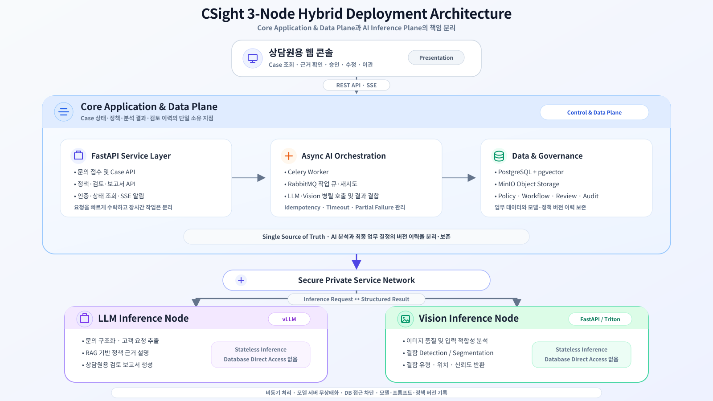
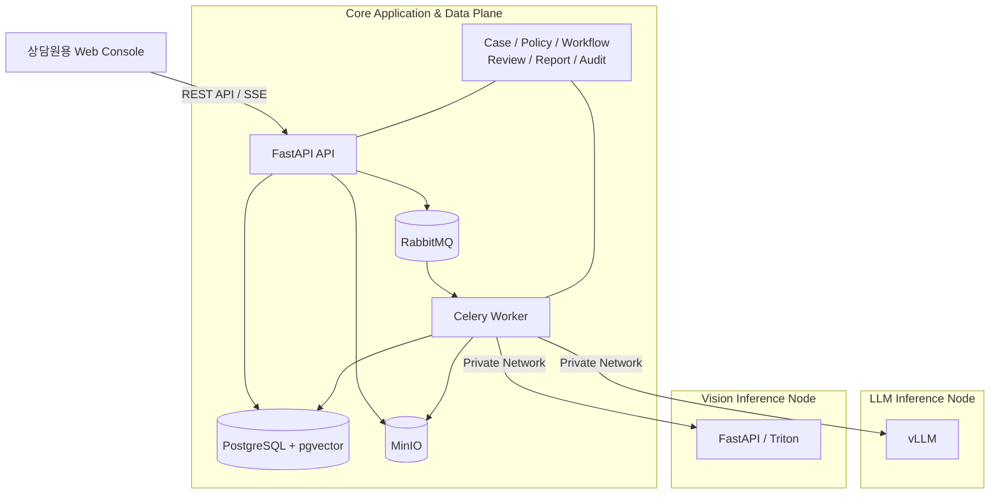
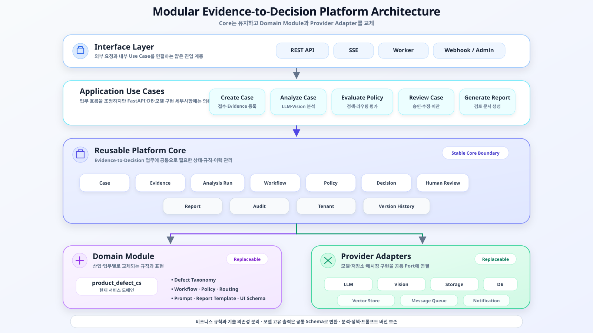
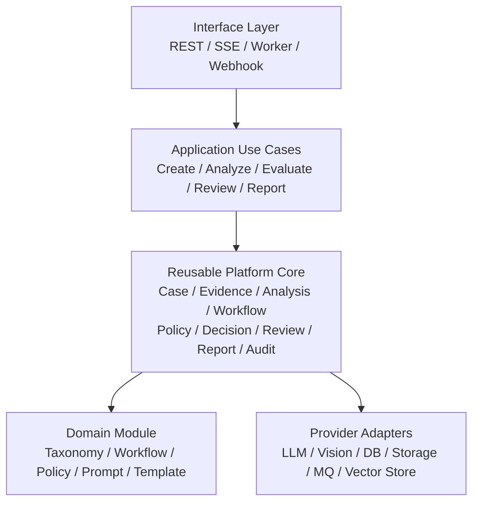
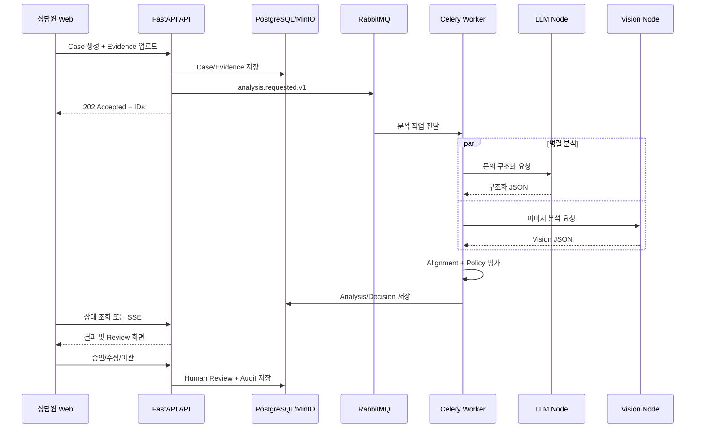
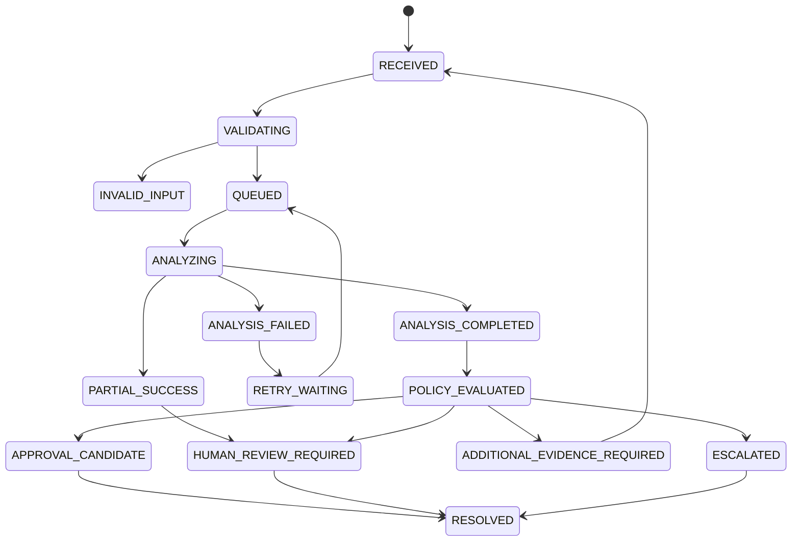

# CSight Project Blueprint

> 프로젝트 기획, 제품 요구사항, 아키텍처, 데이터·모델, 운영, 로드맵을 하나로 합친 통합 문서입니다.


---

# 01. Project Charter

## 1. 프로젝트 정의

**CSight**는 고객 문의의 이미지와 텍스트를 함께 분석하여 상품 결함 검토, 처리 분류, 정책 적용, 문서화를 연결하는 B2B CS 의사결정 지원 플랫폼이다.

### 한 줄 정의

> 고객의 불량 주장과 이미지 증거를 함께 검토하고, 기업 정책에 맞는 처리 경로와 근거 문서를 생성해 CS 처리시간과 운영비용을 줄이는 서비스

## 2. 해결하려는 문제

현재 상품 불량 CS는 일반적으로 다음 흐름으로 처리된다.

```text
문의 접수
→ 상담원이 텍스트와 이미지를 직접 확인
→ 상품·주문·정책 별도 조회
→ 처리 여부 판단
→ 근거와 결과 수기 기록
```

이 과정에는 다음 문제가 존재한다.

- 반복 검토가 문의량 증가에 비례해 늘어난다.
- 동일 사례도 상담원마다 다르게 판단할 수 있다.
- 판정 근거가 자유 서술 또는 미기록 상태로 남는다.
- 단순 문의와 고난도 분쟁이 같은 대기열에 존재한다.
- 상품·금액·결함별 정책을 사람이 직접 확인한다.
- 처리 결과가 품질관리 데이터로 구조화되지 않는다.

## 3. 제품 가설

다음 가설을 PoC에서 검증한다.

1. 텍스트 요약, 이미지 검토, 정책 조회, 보고서 작성의 일부를 연결하면 상담원 검토시간이 감소한다.
2. 분석 근거와 정책을 구조화하면 상담원별 판단 편차와 재검토 비용이 감소한다.
3. 모든 문의를 자동 처리하지 않고 고신뢰 사례만 분리해도 충분한 운영 가치가 발생한다.
4. 이미지·문의·정책·최종 처리 결과를 Case 단위로 축적하면 품질관리 데이터로 재사용할 수 있다.
5. 초기 고객은 자체 상품과 정책을 관리하는 중소·중견 브랜드사 CS 조직이 적합할 가능성이 높다.

## 4. 목표 고객 가설

### 우선 검증 고객

- 자체 온라인몰을 운영하는 중소·중견 브랜드사
- 이미지 기반 불량·파손 문의가 반복되는 조직
- CS 처리 이력과 상품 정책을 보유한 조직

### 사용자와 의사결정자

| 역할 | 관심사 |
|---|---|
| CS 상담원 | 검토시간, 쉬운 근거 확인, 입력 자동화 |
| CS 팀장 | 대기건수, 생산성, 재문의율, 판정 표준화 |
| 품질 담당자 | 상품별 반복 불량, 증거 데이터, 원인 분석 |
| 운영·재무 책임자 | 건당 처리비용, 환불·재검토 비용 |
| IT·보안 책임자 | 연동 난이도, 개인정보, 감사 가능성 |

## 5. 제품 목표

### MVP 목표

- 한 개 고객 환경 또는 가상 고객 환경
- 한 개 상품군
- 2~3개 시각적 결함 유형
- Human-in-the-loop 기반 처리 권고
- Offline Evaluation 완료

### PoC 목표

- Shadow Mode에서 상담원 판단과 결과 비교
- 검토시간, 오버라이드율, 위험 라우팅 오류율 측정
- 기업 데이터 제공 가능 범위와 기존 시스템 연동 가능성 검증

## 6. 비목표

- 전 상품군을 지원하는 범용 결함 AI
- 완전 자율 환불·교환 시스템
- 고객 사기 판정 시스템
- 법적 책임 판정 시스템
- 일반적인 FAQ 챗봇
- 초기 단계의 대규모 Kubernetes 마이크로서비스

## 7. 성공 기준

초기에는 다음 3개를 우선한다.

1. **평균 검토시간 감소**
2. **고신뢰 권고 오버라이드율 감소**
3. **위험 라우팅 오류율 최소화**

정확한 목표값은 멘토링과 기업 인터뷰 후 확정한다. 검증되지 않은 절감률을 사전에 고정하지 않는다.

## 8. 제약과 전제

- Core Backend와 DB는 개발 단계에서 Mac 계열 장비에 배포한다.
- LLM과 Vision 추론은 각각 별도 GPU 서버에서 수행한다.
- 세 노드는 사설망으로 연결한다.
- 실제 기업 데이터 확보 전에는 공개·직접 촬영·합성·가상 정책 데이터로 프로토타입을 검증한다.
- 상용 단계에서는 Core를 Linux 서버 또는 Cloud로 이전할 수 있어야 한다.

## 9. 주요 미결정 사항

- 첫 상품군과 결함 유형
- 실제 협력 기업 또는 데이터 제공 경로
- 기존 CRM 연동 방식과 별도 Web Console 중 우선순위
- PoC 과금 방식
- 정책 엔진의 초기 표현 형식
- 개인정보 보관기간과 삭제 정책
- Vision 모델의 최종 출력 규격

---

# 02. Product Requirements

## 1. 요구사항 표기

- `P0`: MVP에 반드시 필요
- `P1`: PoC 품질 향상에 필요
- `P2`: 상용화 또는 확장 단계

## 2. 주요 사용자 시나리오

### 상담원

1. 상품 불량 문의를 열어 고객 원문, 주문정보, 이미지를 확인한다.
2. 시스템이 추출한 결함 주장과 고객 요청을 확인한다.
3. 이미지 위 결함 후보와 신뢰도를 확인한다.
4. 적용 정책과 처리 권고를 확인한다.
5. 승인, 수정, 추가 자료 요청, 이관 중 하나를 선택한다.
6. 수정 이유를 기록하고 검토 문서를 저장한다.

### 관리자

1. 기업 정책과 Threshold를 버전별로 등록한다.
2. 사용자 권한과 고객사별 설정을 관리한다.
3. 처리시간, 오버라이드율, 실패율, 반복 불량을 조회한다.

### 품질 담당자

1. 상품·결함 유형별 Case를 조회한다.
2. 반복 결함과 증거 이미지를 확인한다.
3. 상담원이 확정한 결과를 품질 분석에 사용한다.

## 3. 기능 요구사항

### Case 및 Evidence

| ID | 우선순위 | 요구사항 | 인수조건 |
|---|---:|---|---|
| CASE-001 | P0 | Case 생성 | 텍스트, 주문 식별자, 고객 요청을 저장하고 Case ID 반환 |
| CASE-002 | P0 | 상태 조회 | Case와 최신 Analysis Run 상태를 조회 가능 |
| CASE-003 | P0 | 상태 이력 | 모든 상태 전환의 시각, 주체, 사유 보존 |
| EVID-001 | P0 | 이미지 업로드 | 원본은 Object Storage, 메타데이터는 DB에 저장 |
| EVID-002 | P0 | 파일 검증 | MIME, 크기, 해시, 허용 확장자 검증 |
| EVID-003 | P1 | 개인정보 마스킹 | 테스트·PoC 정책에 따라 원문 또는 파생본 관리 |

### AI 분석

| ID | 우선순위 | 요구사항 | 인수조건 |
|---|---:|---|---|
| AI-001 | P0 | LLM 문의 구조화 | 결함 주장, 위치, 요청사항, 누락정보를 Schema에 맞춰 반환 |
| AI-002 | P0 | Vision 분석 | 이미지 품질, 결함 유형, 위치, 신뢰도, 모델 버전 반환 |
| AI-003 | P0 | 정합성 분석 | 텍스트 주장과 Vision 결과의 유형·위치 일치도를 산출 |
| AI-004 | P0 | 비동기 실행 | API 요청과 분석 실행을 분리하고 202 응답 반환 |
| AI-005 | P0 | 부분 실패 관리 | LLM 또는 Vision 단일 실패를 구분해 저장 |
| AI-006 | P1 | 재분석 | 모델·프롬프트 버전을 지정해 새 Analysis Run 생성 |
| AI-007 | P1 | 재촬영 가이드 | 이미지 품질 부족 사유에 맞는 촬영 요청 생성 |

### 정책과 라우팅

| ID | 우선순위 | 요구사항 | 인수조건 |
|---|---:|---|---|
| POL-001 | P0 | 정책 버전 관리 | 적용 시작·종료일과 버전 보존 |
| POL-002 | P0 | 정형 규칙 평가 | 기간, 금액, 상품군, 결함, 위험 조건을 코드가 평가 |
| POL-003 | P1 | 비정형 정책 검색 | 정책 문서에서 관련 조항을 검색하고 근거 위치 반환 |
| ROUTE-001 | P0 | 처리 경로 추천 | 승인 후보, 검토, 추가 자료, 이관 중 하나 반환 |
| ROUTE-002 | P0 | 고위험 우선 이관 | 고액·안전사고·분쟁 조건은 자동 승인 후보 금지 |
| ROUTE-003 | P1 | Threshold 설정 | 고객사·상품군·결함별 Threshold 버전 관리 |

### Human Review

| ID | 우선순위 | 요구사항 | 인수조건 |
|---|---:|---|---|
| REV-001 | P0 | 승인·수정·이관 | 상담원이 권고 결과를 확정 또는 변경 가능 |
| REV-002 | P0 | 수정 이유 | 오버라이드 시 이유 코드 또는 메모 필수 |
| REV-003 | P0 | 원본 보존 | AI 권고와 최종 결정 모두 보존 |
| REV-004 | P1 | 재검토 | 상급자 검토 Workflow 지원 |

### 보고서와 감사

| ID | 우선순위 | 요구사항 | 인수조건 |
|---|---:|---|---|
| REP-001 | P0 | 검토 문서 생성 | 문의, 이미지 근거, 분석, 정책, 권고, 확정 이력 포함 |
| REP-002 | P1 | 문서 Export | HTML 또는 PDF Export 가능 |
| AUD-001 | P0 | 감사 로그 | 주요 조회·변경·결정 행위 기록 |
| AUD-002 | P0 | 버전 추적 | 결과에 모델·프롬프트·정책·Threshold 버전 연결 |

### 운영 분석

| ID | 우선순위 | 요구사항 | 인수조건 |
|---|---:|---|---|
| MET-001 | P0 | 처리시간 측정 | 접수·분석·검토·확정 시각 저장 |
| MET-002 | P0 | 오버라이드율 | AI 권고와 최종 판단 차이 집계 |
| MET-003 | P1 | 반복 불량 통계 | 상품·판매자·결함별 집계 |
| MET-004 | P1 | 모델 운영 지표 | Latency, 실패율, 보류율, Schema 오류율 집계 |

## 4. 비기능 요구사항

| ID | 영역 | 요구사항 |
|---|---|---|
| NFR-001 | 보안 | 외부에는 Web/API만 공개하고 DB·GPU API는 사설망으로 제한 |
| NFR-002 | 개인정보 | 원문·이미지 접근권한, 보관기간, 삭제 정책 지원 |
| NFR-003 | 감사 | 처리 결과 재현에 필요한 모든 버전과 입력 참조 보존 |
| NFR-004 | 복원력 | 외부 모델 Timeout, Retry, DLQ, Partial Failure 지원 |
| NFR-005 | 이식성 | Core와 모델 서버의 API 계약을 유지한 채 장비 이전 가능 |
| NFR-006 | 확장성 | Domain Module과 Provider Adapter 교체 가능 |
| NFR-007 | 관측성 | Case 단위 Trace 및 시스템·모델·업무 지표 제공 |
| NFR-008 | 유지보수 | Migration, Type Check, Test, ADR 기반 변경 관리 |

## 5. MVP 인수 시나리오

### 시나리오 A: 명확한 결함

- 선명한 이미지와 누액 주장이 제출된다.
- LLM과 Vision 분석이 성공한다.
- 정책 조건이 충족된다.
- 시스템은 `APPROVAL_CANDIDATE`를 반환한다.
- 상담원이 승인하면 최종 결정과 보고서가 저장된다.

### 시나리오 B: 이미지 부족

- 결함 부위가 보이지 않는 이미지가 제출된다.
- Vision 품질 검사가 실패 사유를 반환한다.
- 시스템은 `ADDITIONAL_EVIDENCE_REQUIRED`로 라우팅한다.
- 구체적인 재촬영 가이드가 제공된다.

### 시나리오 C: 고위험 조건

- 고액 상품 또는 예외 정책 조건이 충족된다.
- 모델 신뢰도가 높더라도 자동 승인 후보를 생성하지 않는다.
- 상급자 또는 전문 담당자 이관 이력이 남는다.

### 시나리오 D: 모델 부분 실패

- Vision 서버가 Timeout되고 LLM은 성공한다.
- Case 데이터는 유실되지 않는다.
- `PARTIAL_SUCCESS` 또는 `HUMAN_REVIEW_REQUIRED`로 처리된다.
- 재시도 이력과 실패 원인이 기록된다.

---

# 03. Architecture

## 1. 아키텍처 목표

- FastAPI 기반으로 빠르게 MVP를 개발한다.
- 하나의 코드베이스를 유지하되 API와 Worker 프로세스를 분리한다.
- Platform Core, Domain Module, Provider Adapter의 경계를 유지한다.
- LLM과 Vision 모델 서버는 독립적인 Stateless Inference Node로 운영한다.
- 업무 데이터와 최종 상태는 Core Application & Data Plane만 소유한다.
- PoC 장비에서 시작하되 Core를 Linux 또는 Cloud로 이전할 수 있게 한다.

## 2. 3-Node 배포 아키텍처





### Core Application & Data Plane

- FastAPI API
- Celery Worker
- PostgreSQL + pgvector
- RabbitMQ
- MinIO
- Case, Policy, Workflow, Review, Report, Audit

### LLM Inference Node

- vLLM
- 문의 구조화
- 검색된 정책 문서 설명
- 상담원용 검토 보고서 생성
- DB 직접 접근 금지

### Vision Inference Node

- 초기 FastAPI Wrapper
- 모델 계약 안정화 후 Triton 검토
- 이미지 품질 분석
- 결함 Detection 또는 Segmentation
- 결함 위치, 유형, 신뢰도 반환
- DB 직접 접근 금지

## 3. 논리적 모듈 아키텍처





## 4. 계층별 책임

### Interface

- HTTP Request/Response 변환
- 인증 정보 추출
- SSE 상태 알림
- Celery·Event 진입점
- Domain 예외를 HTTP 오류로 변환

### Application

- Use Case 순서 조정
- Transaction Boundary
- Port 호출
- Domain 객체와 DTO 변환
- 업무 이벤트 발행

### Platform Core

- Case와 Evidence
- Analysis Run과 Finding
- Workflow와 상태 전환
- Policy와 Decision
- Human Review
- Report와 Audit
- Tenant와 Version History

### Domain Module

`product_defect_cs`에 한정된 다음 내용을 보유한다.

- 결함 Taxonomy
- 결함 위치·심각도
- 주장-증거 Alignment 규칙
- 처리 정책과 라우팅 규칙
- LLM Prompt
- Report Template
- Domain UI Schema

### Provider Adapter

- vLLM 또는 외부 LLM API
- Vision FastAPI 또는 Triton
- PostgreSQL Repository
- MinIO 또는 S3
- RabbitMQ
- pgvector 또는 별도 Vector DB

## 5. 표준 처리 흐름



## 6. 장애 처리

| 상황 | 처리 |
|---|---|
| LLM Timeout | Retry 후 실패 저장, Vision 결과만으로 자동 승인 금지 |
| Vision Timeout | 자동 처리 금지, Human Review 또는 재시도 |
| JSON Schema 오류 | 제한된 횟수 재요청 후 실패 격리 |
| 동일 작업 재전달 | Idempotency 검증 후 중복 저장 차단 |
| RabbitMQ 장애 | Outbox 또는 재발행 가능한 작업 상태 유지 |
| 모델 버전 변경 | 기존 결과 유지, 새 Analysis Run 생성 |
| Core 재시작 | DB에 저장된 상태로 작업 복구 가능 |

## 7. 확장 원칙

- API 처리량이 증가하면 FastAPI Replica를 늘린다.
- AI 작업량이 증가하면 Celery Worker를 늘린다.
- LLM과 Vision 노드는 독립적으로 증설한다.
- Vector 검색 요구가 pgvector 범위를 넘을 때만 별도 Vector DB를 검토한다.
- 상용화 시 Core를 Linux 또는 Cloud로 이동하고 동일 API 계약을 유지한다.
- 마이크로서비스 분리는 실제 팀·배포·확장 문제가 발생한 모듈부터 수행한다.

---

# 04. Domain Model and Workflow

## 1. 공통 용어

| 용어 | 정의 |
|---|---|
| Case | 한 건의 상품 불량 문의와 처리 생명주기 |
| Evidence | 텍스트, 이미지, 주문정보, 상품정보, 정책 문서 등 판단 근거 |
| Analysis Run | 특정 모델·프롬프트·Threshold로 실행한 분석 단위 |
| Finding | LLM 또는 Vision이 반환한 구조화된 관찰 결과 |
| Alignment | 고객 주장과 이미지 증거의 유형·위치·충분성 정합성 |
| Policy | 기업이 정의한 처리 규칙과 유효기간 |
| Decision | 분석과 정책을 결합한 시스템 권고 경로 |
| Review | 담당자의 승인, 수정, 거절, 이관 행위 |
| Report | 문의, 근거, 정책, 권고, 확정 이력을 포함한 문서 |
| Audit | 조회·변경·결정의 추적 이력 |

## 2. 주요 Aggregate

### Case Aggregate

- Case ID
- Tenant ID
- 현재 상태
- 고객 문의
- 주문·상품 참조
- Evidence 목록
- 최신 Analysis Run 참조
- 최신 Decision 참조
- 최종 Review 참조

### Analysis Aggregate

- Analysis Run ID
- Case ID
- 실행 상태
- LLM Result
- Vision Result
- Alignment Result
- 모델·프롬프트·Threshold 버전
- 시작·완료 시각
- 오류와 재시도 이력

### Policy Aggregate

- Policy ID
- Version
- Tenant
- 적용 상품군
- 적용 결함 유형
- 유효기간
- 규칙 조건
- 권고 Action
- 예외·고위험 조건

### Review Aggregate

- Review ID
- AI 권고 원본
- 담당자 최종 결정
- 수정 이유
- 담당자
- 확정 시각

## 3. Case 상태 머신



## 4. 상태 전환 불변조건

- `APPROVAL_CANDIDATE`는 최종 승인 상태가 아니다.
- Vision 분석이 필수인 Domain에서 Vision 실패 시 `APPROVAL_CANDIDATE`가 될 수 없다.
- 고위험 정책 조건이 참이면 모델 신뢰도와 무관하게 담당자 또는 상급자 검토로 이동한다.
- Final Review 전 AI 권고 결과를 수정하거나 삭제하지 않는다.
- 재분석은 기존 Analysis Run을 갱신하지 않고 새 Run을 만든다.
- 모든 상태 전환은 Actor와 Reason을 기록한다.

## 5. 처리 라우팅 매트릭스

| Evidence / Risk | 정책 명확 | 정책 모호·예외 | 고위험 |
|---|---|---|---|
| 고신뢰 | 승인 후보 | 담당자 검토 | 상급자·전문부서 이관 |
| 중간 신뢰 | 담당자 검토 | 담당자 검토 | 이관 |
| 저신뢰 | 추가 자료 요청 | 추가 자료 요청 또는 검토 | 이관 |
| 입력 부적합 | 추가 자료 요청 | 추가 자료 요청 | 추가 자료 요청 후 이관 검토 |

## 6. Alignment 모델

초기 Alignment는 규칙 기반으로 시작한다.

```text
Alignment Score
= 유형 일치 점수
+ 위치 일치 점수
+ 이미지 품질 가중치
+ Vision confidence 가중치
+ Evidence completeness 가중치
```

출력 예시:

```json
{
  "type_match": true,
  "location_match": true,
  "evidence_sufficiency": "HIGH",
  "alignment_score": 0.89,
  "reasons": [
    "고객이 주장한 누액 유형과 Vision 결과가 일치",
    "고객이 언급한 하단 위치와 Detection 영역이 일치"
  ]
}
```

Threshold는 코드 상수가 아니라 버전 관리되는 설정으로 저장한다.

## 7. Policy와 LLM의 경계

### LLM이 수행할 수 있는 것

- 문의 요약
- 결함 주장과 고객 요청 추출
- 정책 문서의 관련 조항 설명
- 보고서 초안 작성

### LLM이 수행하면 안 되는 것

- 최종 환불 승인
- 보상 금액 확정
- 사기 여부 판정
- 법적 책임 확정
- Case 상태 직접 변경

정형 정책은 Python Policy Evaluator가 실행하고, 비정형 정책은 RAG가 근거 조항을 찾는다. LLM은 해당 근거를 설명할 뿐 최종 규칙 실행자가 아니다.

## 8. 다른 서비스로의 확장

공통 Core를 유지하고 다음 Domain Module을 추가할 수 있다.

- `product_defect_cs`
- `return_inspection`
- `delivery_damage`
- `manufacturing_quality_review`

확장 대상은 Evidence를 분석해 정책에 따른 Decision으로 연결하는 유사 업무군으로 제한한다.

---

# 05. API and Event Contracts

## 1. 계약 원칙

- 외부 API는 `/api/v1`으로 버전 관리한다.
- 장시간 분석 요청은 `202 Accepted`를 반환한다.
- 생성·분석 요청은 `Idempotency-Key`를 지원한다.
- Event와 모델 출력에는 `schema_version`을 포함한다.
- 모델 고유 출력은 외부에 직접 노출하지 않고 공통 Schema로 변환한다.
- 원본 AI 결과와 정규화 결과를 구분해 저장할 수 있다.

## 2. HTTP API 초안

### Case

| Method | Path | 설명 |
|---|---|---|
| POST | `/api/v1/cases` | Case 생성 |
| GET | `/api/v1/cases/{case_id}` | Case 상세 조회 |
| GET | `/api/v1/cases` | 필터·페이지 기반 목록 조회 |
| POST | `/api/v1/cases/{case_id}/evidence` | Evidence 추가 |
| GET | `/api/v1/cases/{case_id}/events` | SSE 상태 이벤트 |

### Analysis

| Method | Path | 설명 |
|---|---|---|
| POST | `/api/v1/cases/{case_id}/analysis-runs` | 분석 작업 등록 |
| GET | `/api/v1/analysis-runs/{run_id}` | 분석 상태·결과 조회 |
| POST | `/api/v1/analysis-runs/{run_id}/retry` | 실패 작업 재시도 |

### Policy

| Method | Path | 설명 |
|---|---|---|
| POST | `/api/v1/policies` | 정책 생성 |
| POST | `/api/v1/policies/{policy_id}/versions` | 새 버전 생성 |
| GET | `/api/v1/policies/active` | Case 조건에 맞는 활성 정책 조회 |

### Review

| Method | Path | 설명 |
|---|---|---|
| POST | `/api/v1/cases/{case_id}/reviews` | 승인·수정·이관 저장 |
| GET | `/api/v1/cases/{case_id}/reviews` | Review 이력 조회 |

### Report

| Method | Path | 설명 |
|---|---|---|
| POST | `/api/v1/cases/{case_id}/reports` | 검토 보고서 생성 요청 |
| GET | `/api/v1/reports/{report_id}` | 보고서 조회 |

## 3. Case 생성 예시

```json
{
  "tenant_id": "tenant-a",
  "order_ref": "ORD-2026-0001",
  "product_ref": "SKU-001",
  "customer_message": "용기 하단이 찌그러졌고 내용물이 샜습니다. 교환을 요청합니다.",
  "requested_action": "EXCHANGE",
  "attributes": {
    "order_amount": 42000,
    "days_since_purchase": 3
  }
}
```

응답:

```json
{
  "case_id": "CASE-2026-0001",
  "status": "RECEIVED",
  "created_at": "2026-08-25T13:00:00Z"
}
```

## 4. 분석 등록 예시

```http
POST /api/v1/cases/CASE-2026-0001/analysis-runs
Idempotency-Key: 0192f-example
```

```json
{
  "domain": "product_defect_cs",
  "llm_profile": "default-extraction",
  "vision_profile": "defect-detector-v1",
  "policy_mode": "ACTIVE_VERSION"
}
```

응답:

```json
{
  "analysis_run_id": "AR-2026-0001",
  "status": "QUEUED"
}
```

## 5. LLM 공통 출력

```json
{
  "schema_version": "1.0",
  "model": {
    "provider": "vllm",
    "name": "configured-model",
    "version": "deployment-version"
  },
  "issue_type": "LEAKAGE",
  "claimed_location": "BOTTOM",
  "customer_request": "EXCHANGE",
  "claims": [
    {
      "type": "CONTAINER_DAMAGE",
      "description": "용기 하단이 찌그러졌다고 주장함"
    },
    {
      "type": "LEAKAGE",
      "description": "내용물이 외부로 누출되었다고 주장함"
    }
  ],
  "missing_information": [],
  "summary": "고객은 용기 하단 파손과 누액을 이유로 교환을 요청함"
}
```

## 6. Vision 공통 출력

```json
{
  "schema_version": "1.0",
  "model": {
    "provider": "remote-vision",
    "name": "csight-defect-detector",
    "version": "0.1.0",
    "preprocess_version": "1.0"
  },
  "image_quality": {
    "blurred": false,
    "too_dark": false,
    "product_visible": true,
    "defect_area_visible": true,
    "score": 0.94
  },
  "detections": [
    {
      "label": "LEAKAGE",
      "confidence": 0.87,
      "geometry": {
        "type": "BOUNDING_BOX",
        "coordinate_system": "NORMALIZED",
        "x1": 0.31,
        "y1": 0.48,
        "x2": 0.76,
        "y2": 0.91
      }
    }
  ],
  "latency_ms": 52
}
```

## 7. Event 계약

### `analysis.requested.v1`

```json
{
  "event_id": "EVT-001",
  "event_type": "analysis.requested.v1",
  "occurred_at": "2026-08-25T13:01:00Z",
  "tenant_id": "tenant-a",
  "case_id": "CASE-2026-0001",
  "analysis_run_id": "AR-2026-0001",
  "correlation_id": "CORR-001",
  "evidence_ids": ["EVID-001"]
}
```

### `analysis.completed.v1`

```json
{
  "event_id": "EVT-002",
  "event_type": "analysis.completed.v1",
  "case_id": "CASE-2026-0001",
  "analysis_run_id": "AR-2026-0001",
  "decision": "HUMAN_REVIEW_REQUIRED",
  "completed_at": "2026-08-25T13:01:08Z"
}
```

### `analysis.failed.v1`

```json
{
  "event_id": "EVT-003",
  "event_type": "analysis.failed.v1",
  "case_id": "CASE-2026-0001",
  "analysis_run_id": "AR-2026-0001",
  "failure_stage": "VISION_INFERENCE",
  "retryable": true,
  "error_code": "VISION_TIMEOUT"
}
```

## 8. 표준 오류 응답

```json
{
  "error": {
    "code": "CASE_NOT_FOUND",
    "message": "요청한 Case를 찾을 수 없습니다.",
    "details": {},
    "correlation_id": "CORR-001"
  }
}
```

## 9. Contract Test 항목

- 필수 필드 누락
- Enum 불일치
- 좌표 범위 0~1 검증
- 모델 버전 누락
- Schema Version 불일치
- Timeout 및 재시도
- 동일 Idempotency Key 재요청
- Vision class mapping 변경
- LLM 비정상 JSON 및 추가 자연어 포함

---

# 06. Data and ML Plan

## 1. 핵심 데이터 단위: Case Bundle

모델 학습과 서비스 평가의 기본 단위는 이미지 한 장이 아니라 다음 묶음이다.

```text
고객 문의 텍스트
+ 첨부 이미지
+ 상품·주문 정보
+ 적용 가능한 정책
+ 상담원의 최종 처리 결과
```

## 2. 필요한 데이터 필드

### 공통

- Case ID
- Tenant ID
- 상품군·상품 식별자
- 주문일·접수일
- 고객 문의 원문
- 고객 요청사항
- 이미지 참조
- 정책 버전
- 최종 처리 결과
- 상담원 수정 여부와 이유

### Vision 라벨

- 정상 / 결함 의심 / 결함 확인
- 결함 유형
- 결함 위치
- Bounding Box 또는 Mask
- 심각도
- 이미지 품질
- 상품·결함 부위 노출 여부

### LLM·Alignment 라벨

- 결함 주장
- 주장 위치
- 고객 요청
- 누락 정보
- 텍스트·이미지 유형 일치
- 텍스트·이미지 위치 일치
- Evidence Sufficiency

## 3. 데이터 확보 전략

### 단계 1: 프로토타입

- 공개 결함 이미지 데이터
- 팀 직접 촬영 데이터
- 통제된 방식의 결함 재현 이미지
- 공개 CS 텍스트 또는 자체 작성 사례
- 가상 주문정보와 정책

### 단계 2: 멘토링·기업 검증

- 비식별화된 과거 문의 샘플
- 문의 텍스트와 이미지의 실제 연결 여부 확인
- 최종 처리 결과와 수정 이유 확보 가능성 검증
- 상품별 정책 문서 형식 파악

### 단계 3: PoC

- 특정 상품군과 결함 2~3개
- 과거 Case Replay
- Shadow Mode
- Limited Recommendation

## 4. 데이터 분할

- 동일 상품 또는 동일 촬영 세션이 Train과 Test에 동시에 들어가지 않게 한다.
- 증강본은 원본과 같은 Split에 둔다.
- 동일 고객 문의의 여러 이미지는 하나의 Case로 함께 분할한다.
- 시간 기반 일반화가 중요하면 최신 기간을 Test로 둔다.
- 정책 버전이 다른 Case는 별도 분석이 가능하도록 메타데이터를 보존한다.

권장 Split 예시:

```text
Train 70%
Dev 15%
Test 15%
```

데이터 규모가 작을 경우 K-fold보다 Case 단위 고정 Test를 우선한다.

## 5. Vision 모델 범위

### 담당 기능

- 이미지 품질 판정
- 상품 및 결함 부위 가시성
- 결함 Detection 또는 Segmentation
- 결함 유형과 신뢰도
- 필요 시 심각도 추정

### Vision 담당자의 산출물

```text
model.onnx 또는 model.plan
labels.json
preprocess.yaml
postprocess.yaml
thresholds.json
sample_inputs/
sample_outputs/
model_card.md
evaluation_report.md
```

### 필수 계약 정보

- 입력 크기
- RGB/BGR
- 정규화 방식
- Resize 또는 Letterbox
- Class 목록
- Class별 Threshold
- NMS 설정
- 좌표 체계
- 모델 버전
- 주요 실패 조건

## 6. LLM 범위

### 수행

- 문의 구조화
- 고객 요청 추출
- 누락 정보 탐지
- 정책 문서 근거 설명
- 상담원용 보고서 생성

### 금지

- 최종 환불·교환 결정
- 사기 판정
- 법적 책임 판정
- DB 상태 직접 변경

### 출력 원칙

- 자유 텍스트가 아니라 JSON Schema 기반 출력
- 낮은 Temperature
- Prompt Version 기록
- Validation 실패 시 제한된 재시도
- 고객 입력을 지시가 아닌 데이터로 취급

## 7. RAG 설계

### 정형 정책

PostgreSQL의 구조화된 규칙으로 관리한다.

- 교환 가능 기간
- 금액 한도
- 상품군
- 결함 유형
- Evidence 필수 조건
- 상급자 승인 기준

### 비정형 정책

pgvector 기반 검색 대상으로 관리한다.

- CS 매뉴얼
- 예외 처리 지침
- 품질 기준서
- 판매자 계약 조항
- 배송 파손 책임 가이드

검색 순서:

```text
Tenant / Product / Policy Version Metadata Filter
→ Keyword + Vector Retrieval
→ 근거 문단 반환
→ LLM이 설명 생성
```

정책 검색 결과에는 문서, 섹션, 버전, 유효기간을 포함한다.

## 8. Feedback Loop

상담원 Review를 학습 데이터로 즉시 자동 반영하지 않는다.

```text
AI 권고
→ 상담원 최종 결정
→ 수정 이유 수집
→ 품질 검수
→ 정책 변경 또는 모델 학습 후보로 분리
```

정책 오류와 모델 오류를 분리해 라벨링한다.

## 9. 평가 지표

### Vision

- Class별 Precision / Recall
- mAP 또는 IoU
- Calibration
- 이미지 품질 판정 정확도
- 보류 또는 판정 불가 성능
- 추론 Latency

### LLM

- JSON Schema 성공률
- 필드별 Extraction F1 또는 Accuracy
- 누락 정보 탐지 정확도
- 근거 없는 정책 생성 비율
- Prompt Version별 실패율
- Latency와 Token 사용량

### End-to-End

- Routing Accuracy
- Approval Candidate 위험 오류율
- 상담원 Override율
- 평균 검토시간
- 재검토율
- 추가 자료 요청의 적절성

## 10. 모델 레지스트리

최소 저장 항목:

- Model name / version
- Provider
- Checkpoint 또는 배포 식별자
- Input / Output Schema Version
- Preprocess / Postprocess Version
- Threshold Version
- Dataset Version
- Evaluation 결과
- 배포 시작·종료 시각

---

# 07. Database Design

## 1. 설계 원칙

- 업무 DB의 단일 소유자는 Core Backend다.
- 모델 서버는 DB에 직접 접근하지 않는다.
- 분석 결과는 Append-only로 저장한다.
- 공통 필드는 정규 컬럼, Domain별 유동 필드는 제한적으로 JSONB를 사용한다.
- 모든 업무 테이블은 Tenant 경계를 고려한다.
- 버전과 유효기간을 명시한다.

## 2. Core 테이블

### 조직·사용자

```text
tenants
users
roles
user_roles
```

### Case·Evidence

```text
cases
case_evidence
case_status_history
```

### 분석

```text
analysis_runs
llm_analysis_results
vision_analysis_results
analysis_findings
alignment_results
```

### 정책·결정

```text
policies
policy_versions
policy_rules
policy_documents
policy_chunks
routing_decisions
```

### 검토·보고서·감사

```text
human_reviews
reports
audit_events
outbox_events
```

### 모델·프롬프트

```text
model_registry
prompt_templates
prompt_versions
threshold_versions
retrieval_index_versions
```

## 3. 핵심 컬럼 예시

### `cases`

| 컬럼 | 설명 |
|---|---|
| id | Case ID |
| tenant_id | 고객사 |
| domain_type | product_defect_cs 등 |
| status | 현재 상태 |
| order_ref | 주문 참조 |
| product_ref | 상품 참조 |
| customer_message | 고객 문의 원문 |
| attributes | Domain별 부가정보 JSONB |
| created_at / updated_at | 시각 |

### `analysis_runs`

| 컬럼 | 설명 |
|---|---|
| id | Analysis Run ID |
| case_id | 대상 Case |
| status | 실행 상태 |
| llm_model_version | LLM 버전 |
| vision_model_version | Vision 버전 |
| prompt_version | Prompt 버전 |
| policy_version | 적용 정책 버전 |
| threshold_version | Threshold 버전 |
| started_at / completed_at | 실행 시각 |
| error_code / error_detail | 실패 정보 |

### `human_reviews`

| 컬럼 | 설명 |
|---|---|
| id | Review ID |
| case_id | 대상 Case |
| analysis_run_id | 검토한 분석 |
| recommended_action | AI 권고 |
| final_action | 담당자 결정 |
| override_reason_code | 수정 이유 코드 |
| note | 메모 |
| reviewer_id | 담당자 |
| reviewed_at | 확정 시각 |

## 4. JSONB 사용 기준

JSONB가 적합한 경우:

- Domain별 선택적 속성
- 원본 모델 응답 보존
- 빠르게 변경되는 부가 메타데이터

정규 컬럼이 필요한 경우:

- 검색·정렬·통계에 자주 사용
- 외래키 또는 제약조건 필요
- 정책·금액·기간처럼 정합성이 중요
- 보안·감사 필터에 사용

완전한 EAV 모델은 사용하지 않는다.

## 5. 인덱스

초기 권장:

- `cases(tenant_id, status, created_at)`
- `cases(tenant_id, product_ref)`
- `analysis_runs(case_id, created_at desc)`
- `human_reviews(case_id, reviewed_at desc)`
- `policy_versions(tenant_id, effective_from, effective_to)`
- `audit_events(tenant_id, case_id, occurred_at)`
- `policy_chunks`의 Vector Index는 데이터 규모를 측정한 뒤 HNSW 또는 IVF를 선택

## 6. 권한 분리

- `api_user`: 업무 CRUD
- `worker_user`: 분석·결과·작업 상태 쓰기, 사용자 관리 제한
- `read_analytics_user`: 비식별 집계 조회
- 모델 서버용 DB 계정은 생성하지 않는다.

## 7. Multi-tenancy

MVP는 Shared Database + `tenant_id` 방식으로 시작한다.

- 모든 조회에 Tenant Scope 적용
- Repository 수준에서 누락 방지
- PoC 이후 PostgreSQL RLS 검토
- Tenant별 정책·Prompt·Threshold 분리

## 8. Migration

- 모든 Schema 변경은 Alembic으로 관리한다.
- 수동 운영 DB 변경을 금지한다.
- Migration에는 데이터 Backfill과 Downgrade 영향을 기록한다.
- 모델 Contract 변경과 DB Migration을 동시에 배포할 경우 호환 기간을 둔다.

## 9. 보관과 삭제

별도로 확정할 항목:

- 고객 원문 보관기간
- 원본 이미지 보관기간
- 파생 이미지 및 Bounding Box 보관기간
- Audit 보관기간
- 삭제 요청 시 원본·파생·검색 Index 삭제 범위

PoC에서는 테스트 데이터와 제한된 접근권한을 기본으로 한다.

---

# 08. Security and Operations

## 1. 네트워크 경계

```text
외부 사용자
→ HTTPS Web/API
→ Core Application & Data Plane
→ 사설망
→ LLM / Vision Inference Node
```

### 외부 공개

- Reverse Proxy의 HTTPS 포트

### 사설망 전용

- PostgreSQL
- RabbitMQ
- MinIO 관리·API 포트
- vLLM API
- Vision API 또는 Triton

### 차단

- 외부 → DB
- 외부 → LLM / Vision API
- LLM / Vision → 업무 DB

## 2. 인증과 권한

### MVP

- JWT 기반 인증
- 역할: Admin, Reviewer, QualityViewer
- Tenant Scope

### 기업 PoC 이후

- OIDC / SSO
- 세부 Resource 권한
- 관리자 작업 2차 확인
- PostgreSQL RLS 검토

## 3. 개인정보와 민감정보

- 고객 문의와 이미지에는 이름, 연락처, 주소, 주문정보가 포함될 수 있다.
- 로그에 고객 원문 전체를 남기지 않는다.
- Object Storage 접근은 짧은 만료시간의 Signed URL을 사용한다.
- 개발 데이터는 마스킹 또는 합성 데이터를 우선한다.
- 원본과 파생 데이터의 보관기간을 분리한다.
- 삭제 요청 시 Vector Index와 보고서 파생본까지 범위를 정의한다.

## 4. Secret 관리

- `.env`를 저장소에 Commit하지 않는다.
- `.env.example`에는 키 이름만 제공한다.
- vLLM, Vision, MinIO, DB Credential을 분리한다.
- PoC 이후 Secret Manager 또는 암호화된 CI Secret을 사용한다.

## 5. 파일 보안

- 파일 크기와 MIME 검증
- 허용 확장자 제한
- 해시 저장
- 파일명 직접 경로 사용 금지
- 필요 시 악성 파일 검사
- RabbitMQ 메시지에 이미지 Binary 또는 Base64를 넣지 않는다.

## 6. 장애 대응

| 실패 | 대응 |
|---|---|
| LLM / Vision Timeout | 제한된 Retry + Exponential Backoff |
| 반복 실패 | DLQ 또는 실패 Queue 격리 |
| 단일 모델 실패 | Partial Failure 저장, 자동 승인 금지 |
| Core 재시작 | DB 상태 기반 복구 |
| Object Storage 실패 | 작업 재시도, Case 원본 상태 유지 |
| RabbitMQ 장애 | 작업 등록 상태와 Outbox 재발행 경로 유지 |

## 7. Health Check

- `/health/live`: 프로세스 생존
- `/health/ready`: DB·Queue 등 요청 처리 준비
- LLM `/health`
- Vision `/health`
- 모델 Warm-up 상태
- RabbitMQ Queue Depth
- MinIO 접근 가능성

## 8. 관측성

### System Metric

- API p50 / p95 / p99 Latency
- Error Rate
- Queue Depth
- Task Wait Time
- LLM TTFT / Total Latency
- Vision Inference Latency
- GPU Utilization / VRAM
- Retry / DLQ Count

### AI Metric

- LLM Schema Validation Failure
- Vision Low-confidence Rate
- Image Quality Failure Rate
- Alignment Score 분포
- 모델 버전별 오류율

### Business Metric

- Case 검토시간
- Approval Candidate Override율
- 위험 라우팅 오류율
- 추가 자료 요청률
- 재검토율
- 상품·결함별 반복 문제

로그와 Trace에는 `correlation_id`, `case_id`, `analysis_run_id`, `task_id`를 연결한다.

## 9. 백업

- PostgreSQL 정기 Dump 또는 Volume Snapshot
- MinIO 객체 백업
- Prompt·Policy·Threshold Export
- 복원 절차를 문서화하고 실제 복구 테스트 수행
- 개발 장비 단일 장애를 전제로 PoC 중요 데이터의 외부 백업 유지

## 10. PoC와 상용화 경계

현재 장비 구성은 개발·멘토링·제한된 PoC를 위한 것이다.

상용화 시 우선 이전 대상:

- FastAPI
- Celery Worker
- PostgreSQL
- RabbitMQ
- MinIO

LLM·Vision API 계약은 유지하고 배포 위치만 변경한다.

---

# 09. Testing and Evaluation

## 1. 검증 단계

```text
Offline Evaluation
→ Shadow Mode
→ Limited PoC
→ High-confidence Automation 검토
```

### Offline Evaluation

- 고정 Test Case로 LLM, Vision, Alignment, Policy 평가
- 실제 업무 처리에 영향 없음

### Shadow Mode

- 상담원 기존 판단과 동시에 시스템 실행
- 시스템 결과는 실제 결정에 반영하지 않음
- 오버라이드와 오류 유형 비교

### Limited PoC

- 선택된 상품군과 결함 유형
- 상담원에게 근거와 처리 권고 제공
- 최종 결정은 상담원이 수행

## 2. 테스트 계층

### Unit Test

- Policy 조건
- Alignment 계산
- Workflow 상태 전환
- Domain Validation
- 버전 선택 로직

### Integration Test

- PostgreSQL Repository
- Alembic Migration
- MinIO Upload / Signed URL
- RabbitMQ와 Celery
- pgvector 검색

### Contract Test

- LLM Schema
- Vision Schema
- Event Schema
- API Response
- 모델 버전과 좌표 체계

### E2E Test

- Case 접수부터 Review 확정까지
- 추가 자료 요청 후 재접수
- 부분 실패와 재시도
- 정책 버전 변경 후 재분석

### Security Test

- Tenant 간 데이터 접근 차단
- 만료된 URL
- 권한 없는 Review
- 위험 파일 업로드
- Prompt Injection 입력

## 3. 핵심 E2E 사례

1. 명확한 누액 → 승인 후보 → 상담원 승인
2. 흐린 이미지 → 추가 자료 요청
3. 텍스트와 이미지 불일치 → 담당자 검토
4. 고액 상품 → 상급자 이관
5. Vision Timeout → Partial Failure
6. LLM 비정상 JSON → 재시도 후 실패 격리
7. 동일 Idempotency Key → 중복 작업 미생성
8. 모델 버전 변경 → 기존 결과 유지, 새 Run 추가

## 4. 기술 지표와 업무 지표

### 기술 지표

- Vision Precision / Recall / mAP
- Calibration
- LLM 구조화 성공률
- 필드별 Extraction 정확도
- 평균 분석 Latency
- Timeout과 실패율

### 업무 지표

- 건당 평균 검토시간
- 상담원 1인당 처리건수
- 처리 경로 추천 정확도
- 고신뢰 권고 Override율
- 위험 라우팅 오류율
- 최초 응답시간
- 재문의·재검토율
- 건당 처리비용

## 5. PoC 핵심 KPI

### 1순위

1. 평균 검토시간
2. 고신뢰 권고 Override율
3. 위험 라우팅 오류율

### 2순위

- 추가 자료 요청 적절성
- 재검토율
- 문서 작성시간
- 반복 불량 탐지 활용도

정확한 목표값은 Baseline 측정과 기업 인터뷰 후 확정한다.

## 6. 안전성 Gate 예시

다음 값은 멘토와 협력 기업의 검증 후 숫자를 확정한다.

- 위험 오류가 허용 범위를 넘으면 자동 승인 후보 기능 비활성화
- Vision 품질이 최소 기준 미만이면 판정 중단
- Policy Version이 없으면 Human Review로 이동
- 모델 결과 Schema가 유효하지 않으면 Decision 생성 금지
- 고위험 Flag가 하나라도 존재하면 자동 처리 금지

## 7. ROI 측정

```text
월간 불량 문의 수
= 월간 전체 문의 수 × 불량 문의 비율

월간 시간 절감 가치
= 불량 문의 수 × 건당 절감시간 × 상담원 분당 인건비

월간 총 가치
= 시간 절감
+ 재검토 비용 감소
+ 오승인·오거절 비용 감소
- 시스템 운영비
```

필요 Baseline:

- 월간 문의량
- 이미지 첨부 문의 비율
- 평균 검토시간
- 재검토율
- 오승인·오거절 비용
- 상담원 인건비
- 현재 문서 작성시간

## 8. 품질 Gate

Pull Request 완료 전:

- Unit / Integration / Contract Test 통과
- Ruff와 Type Check 통과
- Migration 검증
- API Schema Diff 검토
- 개인정보 로그 노출 검사
- 주요 E2E Scenario 회귀 없음

---

# 10. Roadmap and Backlog

## 1. 개발 방식

- 2주 단위 Sprint
- 각 Sprint는 실행 가능한 Increment를 남긴다.
- 세부 범위는 멘토링과 데이터 확보 결과에 따라 조정한다.
- 기술 구현과 고객·데이터 검증을 병렬로 진행한다.

## 2. Sprint 계획

### Sprint 0 — Foundation

목표: 개발 기반과 계약 확정

- 저장소와 디렉터리 구조
- `pyproject.toml`, Ruff, Type Check, pytest
- Docker Compose Core 환경
- PostgreSQL, RabbitMQ, MinIO
- Alembic 초기 Migration
- LLM·Vision Mock Adapter
- CI Pipeline
- ADR 확정

완료 기준:

- Core 서비스가 한 명령으로 실행
- Health Check 통과
- Mock 기반 E2E Skeleton 통과

### Sprint 1 — Case and Evidence

- Case CRUD
- Evidence 업로드
- MinIO 저장
- 상태 이력
- 기본 인증과 Tenant Scope
- 상담원 Case 목록·상세 API

완료 기준:

- 텍스트와 이미지가 포함된 Case 접수 가능
- 원본 파일이 DB가 아닌 Object Storage에 저장

### Sprint 2 — Async Analysis and LLM

- Celery + RabbitMQ
- Analysis Run
- vLLM Adapter
- 문의 구조화 Schema
- Retry, Timeout, Idempotency
- Prompt Version

완료 기준:

- API가 202 응답 후 LLM 구조화 결과를 비동기로 저장
- 실패와 재시도 이력 확인 가능

### Sprint 3 — Vision Integration

- Vision Contract 확정
- Mock → 실제 Vision API 전환
- 이미지 품질 결과
- Detection 정규화
- Model Version 저장
- LLM·Vision 병렬 실행

완료 기준:

- Vision 모델 교체가 Domain 코드 수정 없이 가능
- 부분 실패 상태가 정상 저장

### Sprint 4 — Alignment, Policy, Review

- Alignment v1
- Policy Version과 Rule Evaluator
- Routing Decision
- 상담원 승인·수정·이관
- Audit Log

완료 기준:

- 명확·모호·자료부족·고위험 Case가 다른 경로로 분기
- AI 권고와 최종 판단 모두 보존

### Sprint 5 — RAG, Report, Evaluation

- 정책 문서 수집·Chunking
- pgvector 검색
- 근거 조항 연결
- 검토 보고서
- KPI 수집
- Offline Evaluation Dataset

완료 기준:

- Case 단위 보고서 생성
- 모델·정책·프롬프트 버전으로 결과 재현 가능
- 핵심 KPI 산출 가능

### Sprint 6 — Shadow Mode and Mentoring PoC

- Shadow Mode UI 또는 Export
- 상담원 판단 비교
- Override Reason 분석
- 오류 Taxonomy
- ROI Baseline 입력
- 멘토 피드백 반영

완료 기준:

- 실제 또는 시뮬레이션 Case로 End-to-End 평가 리포트 생성

## 3. P0 Backlog

- [ ] 프로젝트 Skeleton과 CI
- [ ] Case / Evidence Domain
- [ ] PostgreSQL / Alembic
- [ ] MinIO Upload
- [ ] Celery / RabbitMQ
- [ ] LLM Structured Output
- [ ] Vision Contract와 Adapter
- [ ] Analysis Run / Versioning
- [ ] Alignment v1
- [ ] Policy Evaluator
- [ ] Routing Decision
- [ ] Human Review
- [ ] Audit Log
- [ ] E2E Test

## 4. P1 Backlog

- [ ] 정책 문서 RAG
- [ ] Report Export
- [ ] SSE 상태 알림
- [ ] Dashboard용 집계 API
- [ ] 재촬영 가이드
- [ ] Prompt 관리 UI
- [ ] 모델 비교 재분석
- [ ] Tenant별 Threshold
- [ ] Shadow Mode 비교 화면

## 5. P2 Backlog

- [ ] OIDC / SSO
- [ ] PostgreSQL RLS
- [ ] Triton 전환
- [ ] Object Storage Lifecycle 자동화
- [ ] 외부 CRM Connector
- [ ] OpenTelemetry 기반 분산 Trace
- [ ] Cloud / Linux Core 배포
- [ ] Domain Module 추가

## 6. 병렬 사업 검증 Backlog

- [ ] 초기 고객군 인터뷰 대상 5곳 선정
- [ ] CS 업무 담당자 인터뷰 질문 확정
- [ ] 월간 이미지 문의량 Baseline 조사
- [ ] 평균 검토시간과 재검토율 조사
- [ ] 데이터 제공 가능 범위 확인
- [ ] CRM/API 연동 가능성 확인
- [ ] PoC 성공 기준 합의
- [ ] 구축비·구독·건당 과금 가설 비교

## 7. 역할 분담

### 차인택

- FastAPI Backend
- Domain / Application / Adapter 구조
- PostgreSQL / pgvector
- RabbitMQ / Celery / MinIO
- RAG
- vLLM 배포와 연동
- Vision API 통합
- 전체 Integration / Observability

### Vision 담당자

- 상품군과 결함 Taxonomy 협의
- 데이터 수집·라벨링
- Vision 모델 학습·평가
- Export와 전처리·후처리 명세
- Class별 Threshold와 실패 사례 제공

### 공동

- 고객 가설
- PoC 범위
- 정책 데이터
- 평가 Case
- 멘토링 자료

## 8. Definition of Done

- 기능 요구사항 충족
- 테스트와 Type Check 통과
- Migration 포함
- API·Event Contract 문서화
- 실패·재시도·로그 처리
- 개인정보 영향 검토
- 모델·프롬프트·정책 버전 기록
- Demo Scenario 실행 가능

---

# 11. Mentoring Decision Log

## 1. 첫 멘토링 목표

- 초기 고객군 우선순위
- 실제 기업 CS Workflow의 진입 지점
- 첫 PoC 상품군과 결함 유형
- PoC 핵심 KPI
- 데이터 제공 가능 범위
- 기존 CRM 연동 방식
- 수익모델과 영업 경로

## 2. 첫 멘토링 질문

1. 중소·중견 브랜드사 CS팀을 초기 고객으로 설정하는 것이 적절한가?
2. 기업이 가장 큰 비용을 지불할 가치는 처리시간, 환불 비용, 판정 표준화, 문서 자동화 중 무엇인가?
3. 첫 PoC에서 반드시 포함할 기능과 제외할 기능은 무엇인가?
4. 별도 상담원 Web과 기존 CRM API 연동 중 어떤 방식이 초기 도입에 현실적인가?
5. 기업이 문의 텍스트, 이미지, 주문정보, 정책, 최종 처리 결과 중 어디까지 제공할 수 있는가?
6. 다음 멘토링까지 하나만 검증한다면 무엇을 우선해야 하는가?

## 3. 결정 기록

| 일자 | 주제 | 결정 | 근거 | 영향 문서 | 담당자 |
|---|---|---|---|---|---|
| YYYY-MM-DD | 예: 초기 고객군 |  |  | Charter / Roadmap |  |

## 4. 회차별 기록 템플릿

### 기본 정보

- 회차:
- 활동일시:
- 장소:
- 멘토:
- 참석자:

### 활동 주제

> CSight의 초기 고객군, 실제 기업 CS 프로세스 연계 방식, PoC 범위, 핵심 성과지표 및 사업화 방향 구체화

### 주요 논의 사항

1. 
2. 
3. 

### 과업 진행 상황

| 영역 | 상태 | 증빙 | 다음 단계 |
|---|---|---|---|
| Backend Architecture | 설계 완료 | Architecture 문서 | Skeleton 구현 |
| LLM Serving | 계획 완료 | vLLM 배포안 | Health/Contract 연결 |
| Vision Model |  |  |  |
| Data | 검증 필요 | Data Plan | 확보 경로 조사 |
| Business | 가설 단계 | Charter | 고객 인터뷰 |

### 이번 회차에서 배운 점

- 가장 중요했던 조언:
- 기존 가설에서 수정할 부분:
- 추가 검증이 필요한 부분:

### Action Items

| 과업 | 담당자 | 완료기한 | 결과물 | 상태 |
|---|---|---|---|---|
|  |  |  |  |  |

## 5. 첫 멘토링 종료 시 최소 확정 항목

- 초기 고객군 1개
- 첫 적용 상품군 1개
- 결함 유형 2~3개
- PoC 업무 범위 1개
- 핵심 KPI 2~3개
- 데이터 확보 방법
- 다음 과업과 담당자·기한

## 6. 미결정 질문 Backlog

- [ ] 상품군 선정 기준은 시각적 판정 용이성인가, 문의량인가, 비용인가?
- [ ] 실제 구매 의사결정자는 CS, 운영, 품질, IT 중 누구인가?
- [ ] 상담원 보조 화면을 별도로 만들 것인가?
- [ ] 기업 정책은 표, 문서, CRM 설정 중 어떤 형태로 존재하는가?
- [ ] 기업이 원본 이미지를 외부 서버로 전송할 수 있는가?
- [ ] PoC 데이터의 개인정보 처리 방식은 무엇인가?
- [ ] PoC 과금은 구축형, 월 구독, 건당 과금 중 무엇이 적합한가?
