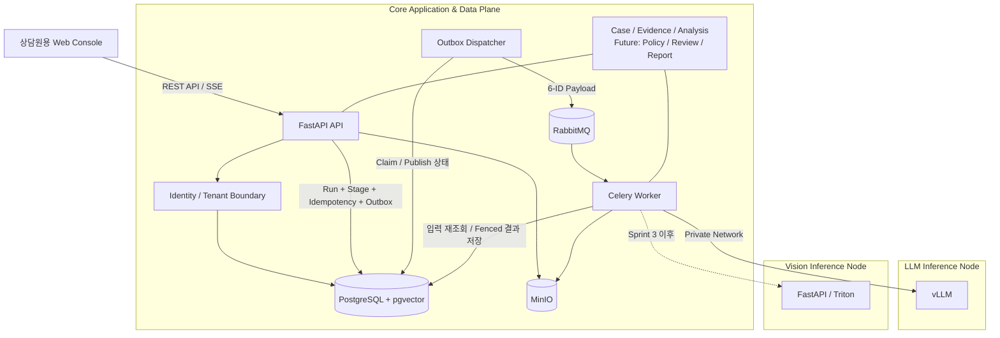
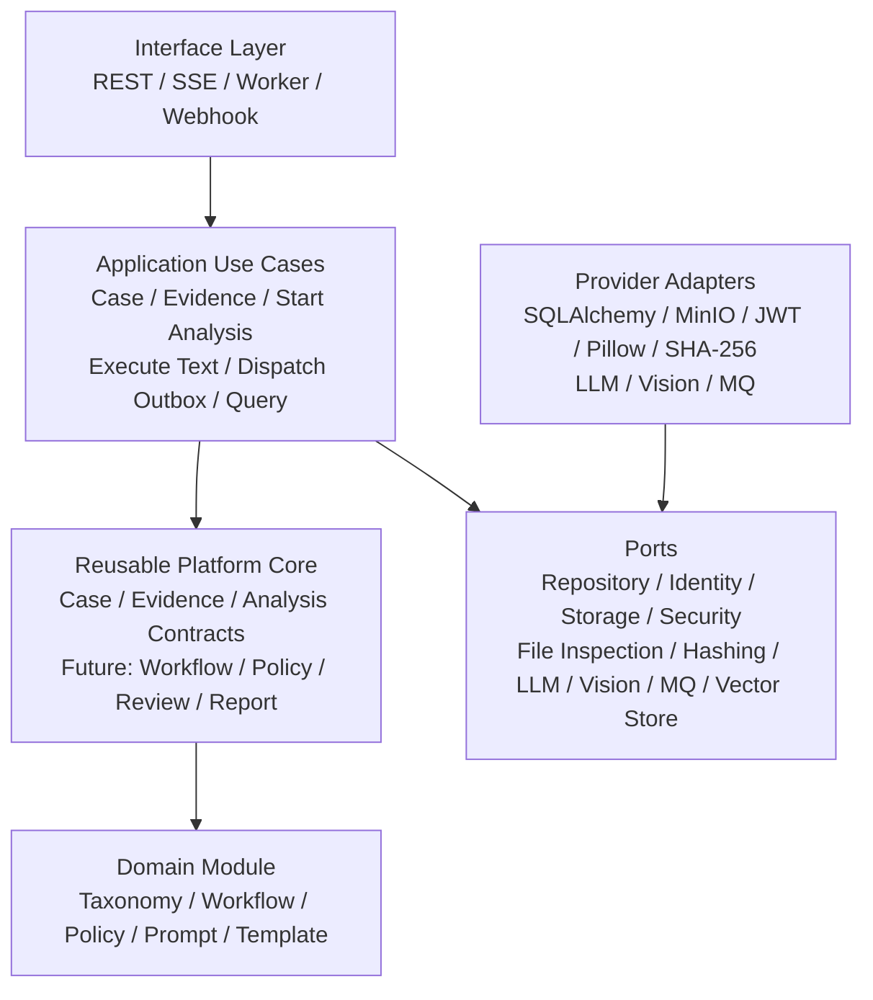
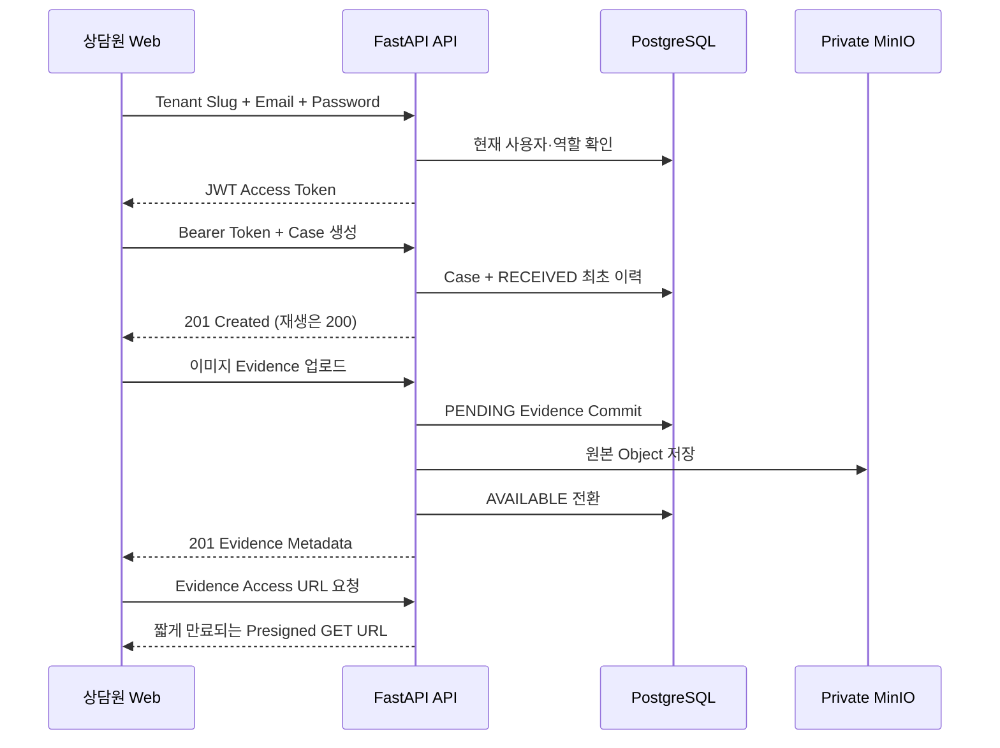
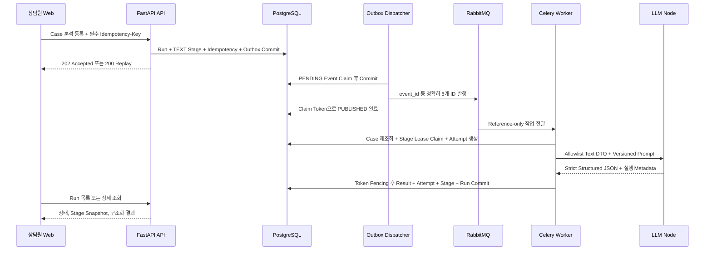

# 03. Architecture

## 1. 아키텍처 목표

- FastAPI 기반으로 빠르게 MVP를 개발한다.
- 하나의 코드베이스를 유지하되 API와 Worker 프로세스를 분리한다.
- Platform Core, Domain Module, Provider Adapter의 경계를 유지한다.
- LLM과 Vision 모델 서버는 독립적인 Stateless Inference Node로 운영한다.
- 업무 데이터와 최종 상태는 Core Application & Data Plane만 소유한다.
- Analysis 등록과 RabbitMQ 발행 사이를 Transactional Outbox로 연결하고, 중복 전달과 늦은
  Worker 응답을 정상적인 장애 조건으로 다룬다.
- PoC 장비에서 시작하되 Core를 Linux 또는 Cloud로 이전할 수 있게 한다.

## 2. 3-Node 배포 아키텍처

### Core Application & Data Plane

- FastAPI API
- Transactional Outbox Dispatcher
- Celery Worker
- PostgreSQL + pgvector
- RabbitMQ
- MinIO
- Case, Evidence와 Append-only Analysis Run/Stage/Attempt
- 후속 범위인 Policy, Workflow, Review, Report, Audit의 확장 경계
- JWT 기반 로컬 Identity와 Tenant Scope

### LLM Inference Node

- vLLM
- Sprint 2의 Strict JSON 문의 구조화
- Sprint 2.5 기준 `csight-qwen3.8-27b`: 고정 Artifact revision, text-only,
  non-thinking, private Tailscale + API 인증
- 검색된 정책 문서 설명과 상담원용 검토 보고서 생성은 후속 범위
- DB 직접 접근 금지

Inference Node 장애는 Core readiness와 분리한다. Worker만 사설 OpenAI-compatible Endpoint를
호출하며 검증된 구조화 결과와 실행 Metadata만 Core DB에 기록한다. 실제 Qwen Artifact의
multimodal architecture는 `--language-model-only`로 제한하고 Vision Stage 계약과 혼합하지
않는다.

### Vision Inference Node

Sprint 2에는 실제 Vision 실행이 연결되어 있지 않다. 다음 항목은 Sprint 3 이후 목표다.

- 초기 FastAPI Wrapper
- 모델 계약 안정화 후 Triton 검토
- 이미지 품질 분석
- 결함 Detection 또는 Segmentation
- 결함 위치, 유형, 신뢰도 반환
- DB 직접 접근 금지

## 3. 논리적 모듈 아키텍처

## 4. 계층별 책임

### Interface

- HTTP Request/Response 변환
- 인증 정보 추출
- SSE 상태 알림
- Celery·Event 진입점
- Domain 예외를 HTTP 오류로 변환

### Application

- Use Case 순서 조정
- Transaction Boundary
- Transactional Outbox 등록·발행과 Claim/Lease 조정
- Port 호출
- Domain 객체와 DTO 변환
- 업무 이벤트 발행
- 인증 Principal에서 Tenant Scope 전달

### Platform Core

- Case와 Evidence
- Analysis Run, Stage Run, Stage Attempt와 Text Extraction Result
- 명시적인 Analysis 상태 전환과 Provider/Prompt/Schema Snapshot
- Workflow, Policy/Decision, Human Review, Report/Audit는 후속 범위
- Tenant와 Version History

### Domain Module

`product_defect_cs`에 한정된 다음 내용을 보유한다.
Sprint 2 구현은 Text Extraction Taxonomy와 Code Prompt까지이며 나머지는 후속 확장 책임이다.

- 결함 Taxonomy
- 결함 위치·심각도
- 주장-증거 Alignment 규칙
- 처리 정책과 라우팅 규칙
- LLM Prompt
- Report Template
- Domain UI Schema

### Provider Adapter

- vLLM 또는 외부 LLM API
- Vision FastAPI 또는 Triton
- PostgreSQL Repository
- Private MinIO 또는 S3와 제한된 Signed URL
- JWT Codec와 Password Hasher
- Pillow 기반 File Inspector와 별도 Bounded SHA-256 Hasher
- RabbitMQ
- pgvector 또는 별도 Vector DB

## 5. 표준 처리 흐름

### Sprint 1 — 동기 Case/Evidence 접수

Sprint 1은 Case나 Evidence를 저장해도 AI 분석을 자동 시작하지 않는다.

### Sprint 2 — Append-only Text Analysis

Sprint 2는 `product_defect_text_extraction` Pipeline `1.0.0`의 `TEXT_EXTRACTION` Stage만
실행한다. API는 Broker에 직접 발행하지 않고 Run, Stage, 분석 Idempotency Record와
`analysis.requested.v1` Outbox Event를 한 PostgreSQL Transaction으로 저장한다.

Provider 호출은 DB Transaction 밖에서 수행한다. Transient 실패는 Run/Stage를
`RETRY_WAITING`으로 전환하고 미래 시각의 새 Outbox Event를 같은 Transaction에 저장한다.
Outbox Dispatcher와 Worker는 At-least-once 전달을 전제로 Claim Token과 Lease로 늦은 쓰기를
차단한다. 활성 Lease 중 중복 작업이 도착해 Claim하지 못하면 그 중복 처리는 Lease 만료 시각에
사용 가능한 Reference-only Recovery Outbox Event 하나를 저장한다. 기존 Worker가 먼저
완료하면 Recovery Delivery는 Terminal No-op이고, 완료하지 못하면 만료 Lease를 회수해 이전
Attempt를 `ABANDONED`로 남긴다. Celery Retry/Ack 상태는 업무 상태의 Source of Truth가 아니며
PostgreSQL의 Run/Stage/Attempt와 Outbox가 복구 상태를 소유한다.

### Sprint 3 이후 — 미구현 흐름

Vision, LLM·Vision 병렬 실행, Alignment, Policy Evaluation, Routing, Human Review, Report,
RAG와 SSE는 Sprint 2에 구현되지 않았다. 이 기능들은 현재 Text Extraction 성공을 최종 업무
결정으로 해석하지 않고 별도 Stage와 Aggregate로 추가한다.

MinIO의 일반 업로드·삭제는 내부 Endpoint를 사용한다. Presigned URL에는 클라이언트가
도달할 별도 Hostname을 사용할 수 있으며, Production에서는 신뢰할 수 있는 Gateway가
서명된 Object GET에 필요한 제한된 경로만 노출한다. Bucket, Console, Admin API는
Private 상태를 유지한다.

## 6. 장애 처리

| 상황 | 처리 |
|---|---|
| LLM Timeout/Unavailable | `RETRY_WAITING` + 제한된 지수 Backoff + 미래 Outbox; 소진 시 `FAILED` |
| LLM 영구 오류/Schema·Quote 오류 | 재시도 없이 Attempt·Stage·Run `FAILED` |
| Vision Timeout | Sprint 3 이후 범위; 자동 처리 금지 원칙 유지 |
| 동일 작업 재전달 | Stage Claim Token, Lease와 Result Unique Constraint로 중복·늦은 쓰기 차단 |
| RabbitMQ 장애 | Outbox를 Backoff 후 재발행; 소진 시 미실행 Run·Stage를 `OUTBOX_DISPATCH_FAILED` 처리 |
| 모델 버전 변경 | 기존 결과 유지, 새 Analysis Run 생성 |
| Core 재시작 | DB에 저장된 상태로 작업 복구 가능 |
| Evidence Object 저장 실패 | Object 삭제와 `FAILED` 전환을 최선 노력으로 수행, 성공 응답 금지 |
| Evidence 최종 DB 갱신 실패 | Object 삭제 후 `FAILED` 전환 시도, 후속 Reconciliation 필요 |

## 7. 확장 원칙

- API 처리량이 증가하면 FastAPI Replica를 늘린다.
- AI 작업량이 증가하면 Celery Worker를 늘린다.
- LLM과 Vision 노드는 독립적으로 증설한다.
- Vector 검색 요구가 pgvector 범위를 넘을 때만 별도 Vector DB를 검토한다.
- 상용화 시 Core를 Linux 또는 Cloud로 이동하고 동일 API 계약을 유지한다.
- 마이크로서비스 분리는 실제 팀·배포·확장 문제가 발생한 모듈부터 수행한다.

## 8. Accepted Architecture Decisions

- [ADR-0009: Transactional Outbox와 Fenced Analysis 실행](adr/0009-transactional-outbox-and-fenced-analysis-execution.md)
- [ADR-0010: Code Prompt Registry와 구조화 결과만 보존](adr/0010-code-prompt-registry-and-structured-output-retention.md)
- [ADR-0011: Case와 Analysis Run 수명주기 분리](adr/0011-separate-case-and-analysis-lifecycles.md)

## 9. Sprint 3 Multimodal Architecture

`product_defect_multimodal_analysis`은 한 트랜잭션에서 Text/Vision Stage와 독립 Outbox Event를
만든다. Dispatcher는 동일한 reference-only Event 계약으로 RabbitMQ에 fan-out하고 Worker는
DB의 Stage type을 조회해 Text 또는 Vision Application use case로 라우팅한다. Celery chord가
아니라 각 Stage terminal 전이 시 PostgreSQL 상태를 재집계해 join한다.

Vision Worker는 `analysis_run_evidence` Snapshot만 읽고 MinIO에서 bounded read와 SHA-256
검증을 수행한다. Vision Provider에는 DB/MinIO credential, object key, Signed URL을 주지 않는다.
Remote HTTP, native taxonomy와 pixel normalization은 `app/adapters/vision`에만 존재한다.

- [ADR-0013: Canonical Vision Result](adr/0013-canonical-vision-result-schema.md)
- [ADR-0014: Evidence Snapshot](adr/0014-analysis-evidence-snapshot.md)
- [ADR-0015: Multimodal Fan-out/Join](adr/0015-multimodal-fanout-join.md)
- [ADR-0016: Partial Success](adr/0016-partial-success-semantics.md)
- [ADR-0017: Vision Taxonomy Boundary](adr/0017-vision-taxonomy-boundary.md)
