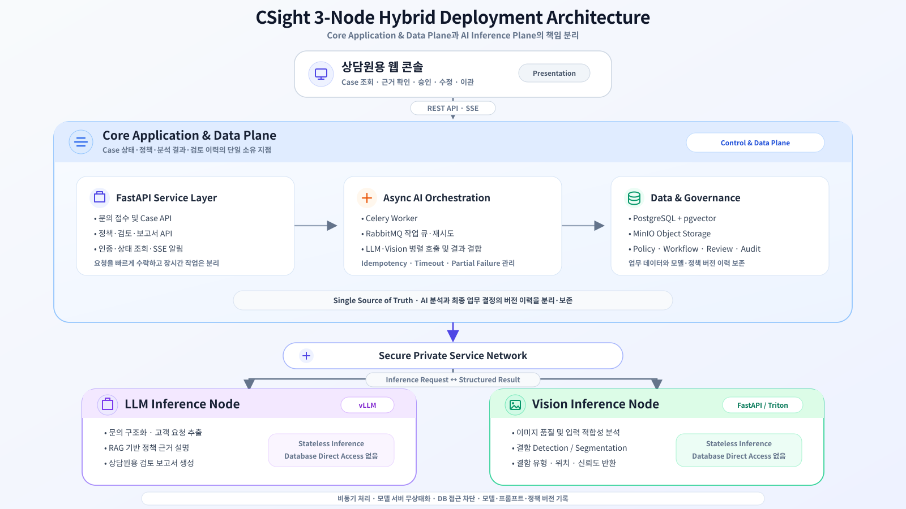
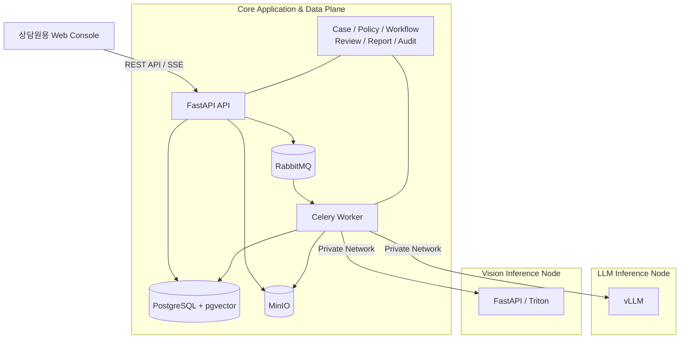
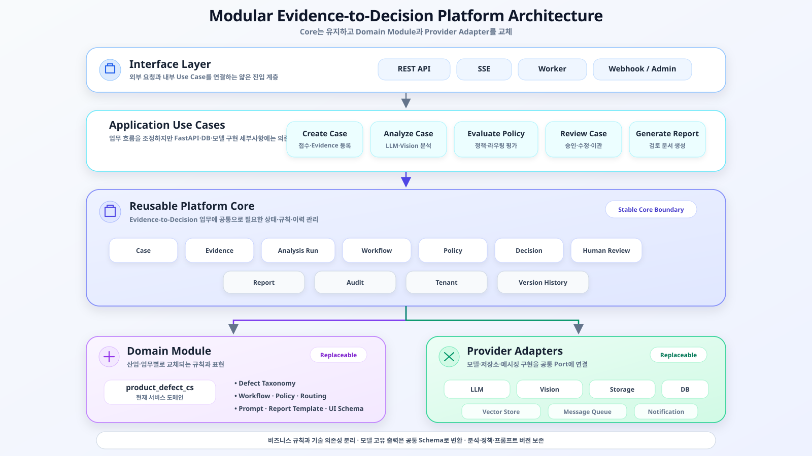
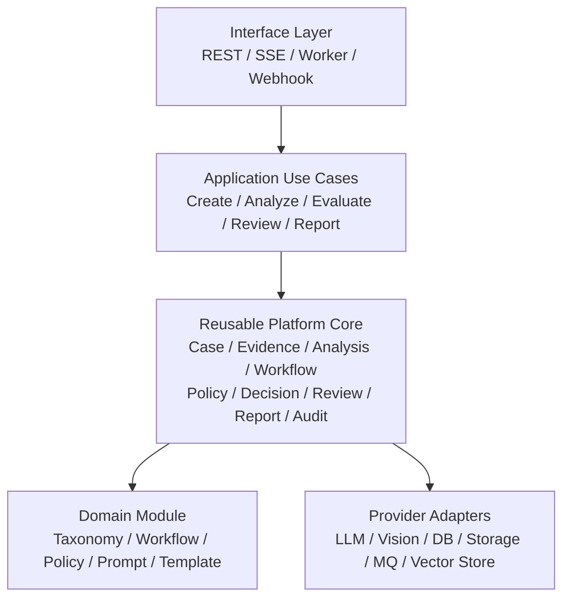
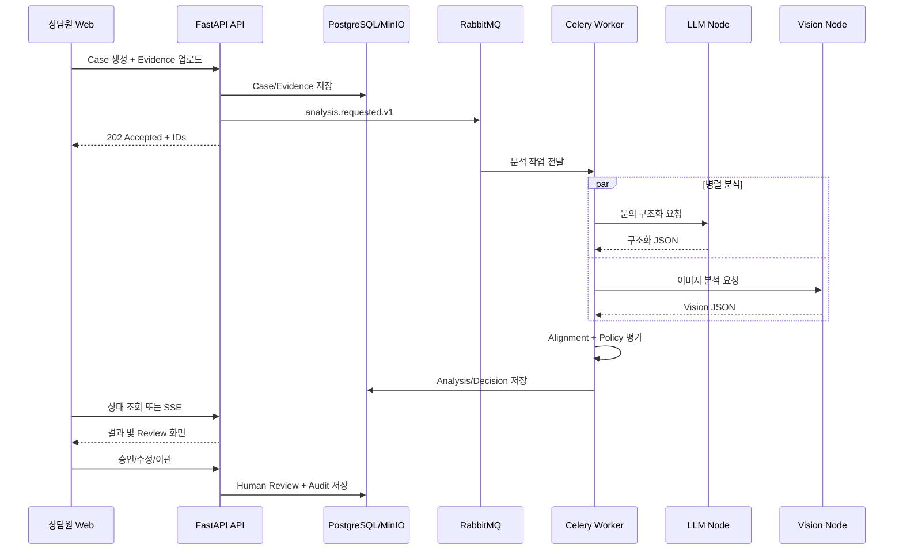

# 03. Architecture

## 1. 아키텍처 목표

- FastAPI 기반으로 빠르게 MVP를 개발한다.
- 하나의 코드베이스를 유지하되 API와 Worker 프로세스를 분리한다.
- Platform Core, Domain Module, Provider Adapter의 경계를 유지한다.
- LLM과 Vision 모델 서버는 독립적인 Stateless Inference Node로 운영한다.
- 업무 데이터와 최종 상태는 Core Application & Data Plane만 소유한다.
- PoC 장비에서 시작하되 Core를 Linux 또는 Cloud로 이전할 수 있게 한다.

## 2. 3-Node 배포 아키텍처

### Core Application & Data Plane

- FastAPI API
- Celery Worker
- PostgreSQL + pgvector
- RabbitMQ
- MinIO
- Case, Policy, Workflow, Review, Report, Audit

### LLM Inference Node

- vLLM
- 문의 구조화
- 검색된 정책 문서 설명
- 상담원용 검토 보고서 생성
- DB 직접 접근 금지

### Vision Inference Node

- 초기 FastAPI Wrapper
- 모델 계약 안정화 후 Triton 검토
- 이미지 품질 분석
- 결함 Detection 또는 Segmentation
- 결함 위치, 유형, 신뢰도 반환
- DB 직접 접근 금지

## 3. 논리적 모듈 아키텍처

## 4. 계층별 책임

### Interface

- HTTP Request/Response 변환
- 인증 정보 추출
- SSE 상태 알림
- Celery·Event 진입점
- Domain 예외를 HTTP 오류로 변환

### Application

- Use Case 순서 조정
- Transaction Boundary
- Port 호출
- Domain 객체와 DTO 변환
- 업무 이벤트 발행

### Platform Core

- Case와 Evidence
- Analysis Run과 Finding
- Workflow와 상태 전환
- Policy와 Decision
- Human Review
- Report와 Audit
- Tenant와 Version History

### Domain Module

`product_defect_cs`에 한정된 다음 내용을 보유한다.

- 결함 Taxonomy
- 결함 위치·심각도
- 주장-증거 Alignment 규칙
- 처리 정책과 라우팅 규칙
- LLM Prompt
- Report Template
- Domain UI Schema

### Provider Adapter

- vLLM 또는 외부 LLM API
- Vision FastAPI 또는 Triton
- PostgreSQL Repository
- MinIO 또는 S3
- RabbitMQ
- pgvector 또는 별도 Vector DB

## 5. 표준 처리 흐름

## 6. 장애 처리

| 상황 | 처리 |
|---|---|
| LLM Timeout | Retry 후 실패 저장, Vision 결과만으로 자동 승인 금지 |
| Vision Timeout | 자동 처리 금지, Human Review 또는 재시도 |
| JSON Schema 오류 | 제한된 횟수 재요청 후 실패 격리 |
| 동일 작업 재전달 | Idempotency 검증 후 중복 저장 차단 |
| RabbitMQ 장애 | Outbox 또는 재발행 가능한 작업 상태 유지 |
| 모델 버전 변경 | 기존 결과 유지, 새 Analysis Run 생성 |
| Core 재시작 | DB에 저장된 상태로 작업 복구 가능 |

## 7. 확장 원칙

- API 처리량이 증가하면 FastAPI Replica를 늘린다.
- AI 작업량이 증가하면 Celery Worker를 늘린다.
- LLM과 Vision 노드는 독립적으로 증설한다.
- Vector 검색 요구가 pgvector 범위를 넘을 때만 별도 Vector DB를 검토한다.
- 상용화 시 Core를 Linux 또는 Cloud로 이동하고 동일 API 계약을 유지한다.
- 마이크로서비스 분리는 실제 팀·배포·확장 문제가 발생한 모듈부터 수행한다.
