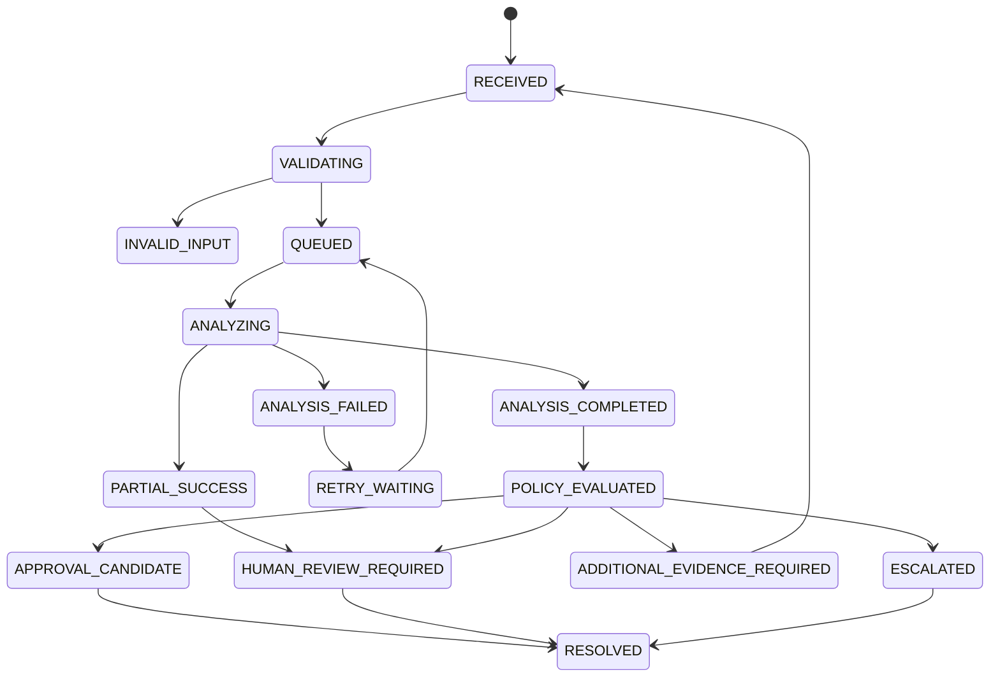

# 04. Domain Model and Workflow

## 1. 공통 용어

| 용어 | 정의 |
|---|---|
| Case | 한 건의 상품 불량 문의와 처리 생명주기 |
| Evidence | 텍스트, 이미지, 주문정보, 상품정보, 정책 문서 등 판단 근거 |
| Analysis Run | 특정 모델·프롬프트·Threshold로 실행한 분석 단위 |
| Finding | LLM 또는 Vision이 반환한 구조화된 관찰 결과 |
| Alignment | 고객 주장과 이미지 증거의 유형·위치·충분성 정합성 |
| Policy | 기업이 정의한 처리 규칙과 유효기간 |
| Decision | 분석과 정책을 결합한 시스템 권고 경로 |
| Review | 담당자의 승인, 수정, 거절, 이관 행위 |
| Report | 문의, 근거, 정책, 권고, 확정 이력을 포함한 문서 |
| Audit | 조회·변경·결정의 추적 이력 |

## 2. 주요 Aggregate

### Case Aggregate

- Case ID
- Tenant ID
- 현재 상태
- 고객 문의
- 주문·상품 참조
- Evidence 목록
- 최신 Analysis Run 참조
- 최신 Decision 참조
- 최종 Review 참조

### Analysis Aggregate

- Analysis Run ID
- Case ID
- 실행 상태
- LLM Result
- Vision Result
- Alignment Result
- 모델·프롬프트·Threshold 버전
- 시작·완료 시각
- 오류와 재시도 이력

### Policy Aggregate

- Policy ID
- Version
- Tenant
- 적용 상품군
- 적용 결함 유형
- 유효기간
- 규칙 조건
- 권고 Action
- 예외·고위험 조건

### Review Aggregate

- Review ID
- AI 권고 원본
- 담당자 최종 결정
- 수정 이유
- 담당자
- 확정 시각

## 3. Case 상태 머신



## 4. 상태 전환 불변조건

- `APPROVAL_CANDIDATE`는 최종 승인 상태가 아니다.
- Vision 분석이 필수인 Domain에서 Vision 실패 시 `APPROVAL_CANDIDATE`가 될 수 없다.
- 고위험 정책 조건이 참이면 모델 신뢰도와 무관하게 담당자 또는 상급자 검토로 이동한다.
- Final Review 전 AI 권고 결과를 수정하거나 삭제하지 않는다.
- 재분석은 기존 Analysis Run을 갱신하지 않고 새 Run을 만든다.
- 모든 상태 전환은 Actor와 Reason을 기록한다.

## 5. 처리 라우팅 매트릭스

| Evidence / Risk | 정책 명확 | 정책 모호·예외 | 고위험 |
|---|---|---|---|
| 고신뢰 | 승인 후보 | 담당자 검토 | 상급자·전문부서 이관 |
| 중간 신뢰 | 담당자 검토 | 담당자 검토 | 이관 |
| 저신뢰 | 추가 자료 요청 | 추가 자료 요청 또는 검토 | 이관 |
| 입력 부적합 | 추가 자료 요청 | 추가 자료 요청 | 추가 자료 요청 후 이관 검토 |

## 6. Alignment 모델

초기 Alignment는 규칙 기반으로 시작한다.

```text
Alignment Score
= 유형 일치 점수
+ 위치 일치 점수
+ 이미지 품질 가중치
+ Vision confidence 가중치
+ Evidence completeness 가중치
```

출력 예시:

```json
{
  "type_match": true,
  "location_match": true,
  "evidence_sufficiency": "HIGH",
  "alignment_score": 0.89,
  "reasons": [
    "고객이 주장한 누액 유형과 Vision 결과가 일치",
    "고객이 언급한 하단 위치와 Detection 영역이 일치"
  ]
}
```

Threshold는 코드 상수가 아니라 버전 관리되는 설정으로 저장한다.

## 7. Policy와 LLM의 경계

### LLM이 수행할 수 있는 것

- 문의 요약
- 결함 주장과 고객 요청 추출
- 정책 문서의 관련 조항 설명
- 보고서 초안 작성

### LLM이 수행하면 안 되는 것

- 최종 환불 승인
- 보상 금액 확정
- 사기 여부 판정
- 법적 책임 확정
- Case 상태 직접 변경

정형 정책은 Python Policy Evaluator가 실행하고, 비정형 정책은 RAG가 근거 조항을 찾는다. LLM은 해당 근거를 설명할 뿐 최종 규칙 실행자가 아니다.

## 8. 다른 서비스로의 확장

공통 Core를 유지하고 다음 Domain Module을 추가할 수 있다.

- `product_defect_cs`
- `return_inspection`
- `delivery_damage`
- `manufacturing_quality_review`

확장 대상은 Evidence를 분석해 정책에 따른 Decision으로 연결하는 유사 업무군으로 제한한다.
