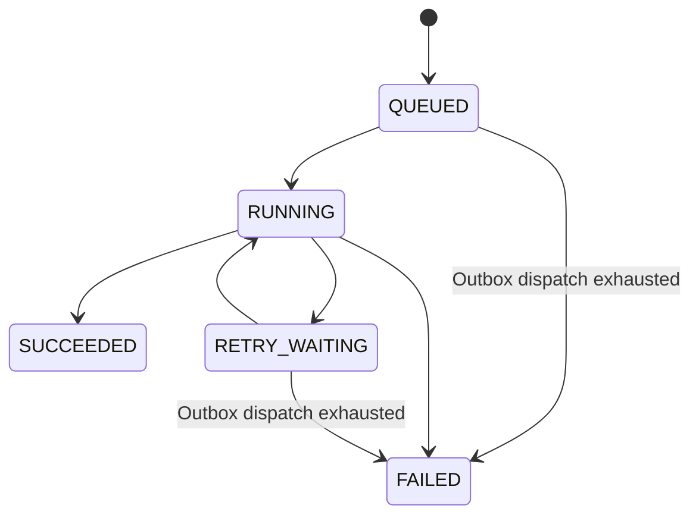
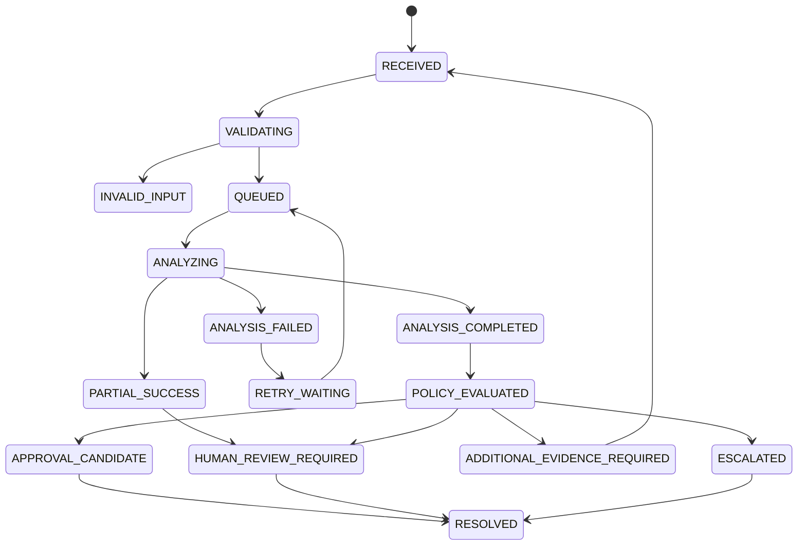

# 04. Domain Model and Workflow

## 1. 공통 용어

| 용어 | 정의 |
|---|---|
| Case | 한 건의 상품 불량 문의와 처리 생명주기 |
| Evidence | 텍스트, 이미지, 주문정보, 상품정보, 정책 문서 등 판단 근거 |
| Analysis Run | 한 Case에 대해 등록된 Pipeline 실행 단위; 재분석마다 새 Run을 만든다 |
| Analysis Stage Run | Pipeline의 한 단계와 Provider·Model·Prompt·Schema Snapshot |
| Analysis Stage Attempt | Claim Token으로 식별되는 한 번의 Provider 실행과 결과·실패 이력 |
| Text Extraction Result | 검증된 LLM 구조화 결과; 성공 Run/Stage당 최대 하나인 Append-only Record |
| Finding | LLM 또는 Vision이 반환할 일반화된 관찰 결과; Sprint 2 별도 Finding Table은 없음 |
| Alignment | 고객 주장과 이미지 증거의 유형·위치·충분성 정합성 |
| Policy | 기업이 정의한 처리 규칙과 유효기간 |
| Decision | 분석과 정책을 결합한 시스템 권고 경로 |
| Review | 담당자의 승인, 수정, 거절, 이관 행위 |
| Report | 문의, 근거, 정책, 권고, 확정 이력을 포함한 문서 |
| Audit | 조회·변경·결정의 추적 이력 |
| Principal | 현재 활성 사용자, Tenant와 DB에서 다시 확인한 역할의 인증 Snapshot |
| Evidence Upload Status | PostgreSQL과 Object Storage 사이 업로드 진행 상태 |

## 2. 주요 Aggregate

### Case Aggregate

- Case ID
- Tenant ID
- Domain Type (`product_defect_cs`)
- 현재 상태
- 고객 문의
- 주문·상품 참조
- 고객 요청 (`EXCHANGE`, `REFUND`, `RETURN`, `REPAIR`, `INFORMATION`, `OTHER`,
  `UNSPECIFIED`)
- JSON 호환 부가 속성
- 생성자와 UTC 생성·갱신 시각
- Evidence 목록은 Evidence Repository 조회로 조합
- 최신 Analysis Run은 별도 Analysis Repository 조회로 조합하며 Case Row에 복제하지 않음
- 최신 Decision과 최종 Review 참조는 Sprint 4 이후 미구현 범위

Sprint 1에서 Case는 `RECEIVED`로만 생성한다. 생성과 같은 Transaction에서
`from_status = null`, `to_status = RECEIVED`, 생성 사용자를 Actor로 하고
`reason = case_created`인 최초 상태 이력을 저장한다. Case 생성 Body에는 Tenant를 받지
않고 인증 Principal의 Tenant를 사용한다.

### Evidence Aggregate

- Evidence ID, Tenant ID, Case ID
- 유형 (`IMAGE`; Enum은 후속 확장을 위한 다른 값을 보유할 수 있음)
- 업로드 상태 (`PENDING`, `AVAILABLE`, `FAILED`)
- Storage Bucket과 서버 생성 Object Key
- 정규화한 원본 파일명, 실제 MIME, 크기, SHA-256
- 이미지 폭·높이
- 생성자와 UTC 생성·갱신 시각

Sprint 1의 공개 업로드는 `IMAGE`만 지원한다. Object Key는 다음 불변 형식이며 원본
파일명을 포함하지 않는다.

```text
tenants/{tenant_id}/cases/{case_id}/evidence/{evidence_id}/original
```

`AVAILABLE`은 Private Object 저장과 메타데이터 확인이 끝난 상태다. `FAILED`는 저장 또는
보상 과정이 실패한 업무 상태이며 성공한 Evidence로 취급하지 않는다.

### Analysis Aggregate

- `AnalysisRun`: Tenant/Case, Pipeline `product_defect_text_extraction`, Pipeline Version
  `1.0.0`, Trigger `USER_REQUEST`, 요청자·Correlation·Idempotency Hash, 상태와 시각
- `AnalysisStageRun`: Sprint 2 실행 Stage `TEXT_EXTRACTION`, Provider/Model/Revision,
  Prompt Name/Version/Content Hash, Input/Output Schema Version `1.0`, Attempt Summary,
  Claim Token/Lease와 다음 재시도 시각
- `AnalysisStageAttempt`: Attempt Number, Execution Token, 등록 당시 Provider/Model/Prompt/Schema
  Snapshot, 실행 Metadata, 시작·완료 시각과 정규화된 실패
- `LLMExtractionResult`: `language`, `issue_types`, `claims`, `requested_action`,
  `missing_information`, `summary`, Schema Version
- Run/Stage/Attempt와 성공 결과는 기존 실행을 덮어쓰는 재분석 경로를 제공하지 않는다.
- Provider Request ID, Input/Output Token 수와 Latency는 실행 Metadata로 저장하지만 전체
  Prompt와 Raw Provider Response는 저장하지 않는다.

Vision Result, Alignment Result, Policy/Threshold Snapshot, Routing Decision은 이 Aggregate의
후속 확장 지점이며 Sprint 2에는 생성되지 않는다.

### Analysis 상태 머신

Run과 Stage는 동일한 다섯 상태를 사용한다.



- `SUCCEEDED`와 `FAILED`는 Terminal이며 이후 전이를 금지한다.
- `RUNNING` Stage만 Claim Token과 Lease를 가진다. 완료·실패 쓰기는 같은 Token으로 조건부
  전이될 때만 허용한다.
- Provider Attempt 상태는 `RUNNING`, `RETRY_WAITING`, `SUCCEEDED`, `FAILED`, `ABANDONED`다.
  만료된 Lease를 회수하면 이전 `RUNNING` Attempt를 `ABANDONED`로 남긴다.
- Transient 실패는 Attempt/Stage/Run을 `RETRY_WAITING`으로 기록하고 다음 Outbox Event를
  같은 Transaction에 추가한다. 영구 실패 또는 최대 시도 소진은 `FAILED`다.
- 활성 Lease 중 도착한 중복 Delivery는 현재 Claim을 침범하지 않고 Lease 만료 시각의
  Reference-only Recovery Outbox Event 하나를 저장한다. 기존 Claim Token의 늦은 완료는
  Fencing되고, Lease 회수 뒤 이전 Attempt는 `ABANDONED`다.
- Celery 자체 Retry 상태는 업무 상태가 아니다. Run/Stage/Attempt와 미래 Outbox Event가
  재시도·복구의 Source of Truth다.
- `QUEUED` 또는 `RETRY_WAITING` 상태에서 Outbox 발행 최대 횟수를 소진하면
  `OUTBOX_DISPATCH_FAILED`로 실패시킨다.

세부 결정은 [ADR-0009](adr/0009-transactional-outbox-and-fenced-analysis-execution.md)와
[ADR-0011](adr/0011-separate-case-and-analysis-lifecycles.md)을 따른다.

### Policy Aggregate

Sprint 2에는 Policy Aggregate가 구현되지 않았다. 다음은 Sprint 4 이후 목표다.

- Policy ID
- Version
- Tenant
- 적용 상품군
- 적용 결함 유형
- 유효기간
- 규칙 조건
- 권고 Action
- 예외·고위험 조건

### Review Aggregate

Sprint 2에는 Review Aggregate가 구현되지 않았다. 다음은 Sprint 4 이후 목표다.

- Review ID
- AI 권고 원본
- 담당자 최종 결정
- 수정 이유
- 담당자
- 확정 시각

## 3. Case 상태 머신

아래는 전체 목표 Case 상태 머신이다. Sprint 1은 `RECEIVED` 생성과 최초 이력까지 구현했다.
Sprint 2의 Analysis 등록·성공·실패도 Case 상태를 변경하지 않으며 Analysis의 기술 상태는
별도 Run/Stage에만 기록한다.



## 4. 상태 전환 불변조건

- 새 Case는 반드시 `RECEIVED`에서 시작하며 최초 상태 이력을 함께 저장한다.
- 외부 요청의 `tenant_id`는 Domain 식별 근거로 사용하지 않는다.
- 다른 Tenant의 Case·Evidence 존재 여부를 공개하지 않는다.
- Evidence 업로드는 Case 상태를 분석 관련 상태로 전환하지 않는다.
- Analysis Run 등록·재시도·실패·성공은 Sprint 2에서 Case 상태를 자동 변경하지 않는다.
- `APPROVAL_CANDIDATE`는 최종 승인 상태가 아니다.
- Vision 분석이 필수인 Domain에서 Vision 실패 시 `APPROVAL_CANDIDATE`가 될 수 없다.
- 고위험 정책 조건이 참이면 모델 신뢰도와 무관하게 담당자 또는 상급자 검토로 이동한다.
- Final Review 전 AI 권고 결과를 수정하거나 삭제하지 않는다.
- 재분석은 기존 Analysis Run을 갱신하지 않고 새 Run을 만든다.
- 모든 상태 전환은 Actor와 Reason을 기록한다.

## 5. 처리 라우팅 매트릭스

아래 매트릭스는 Sprint 4 이후 목표이며 Sprint 2 Text Extraction은 어떤 행도 자동 선택하지
않는다.

| Evidence / Risk | 정책 명확 | 정책 모호·예외 | 고위험 |
|---|---|---|---|
| 고신뢰 | 승인 후보 | 담당자 검토 | 상급자·전문부서 이관 |
| 중간 신뢰 | 담당자 검토 | 담당자 검토 | 이관 |
| 저신뢰 | 추가 자료 요청 | 추가 자료 요청 또는 검토 | 이관 |
| 입력 부적합 | 추가 자료 요청 | 추가 자료 요청 | 추가 자료 요청 후 이관 검토 |

## 6. Alignment 모델

Alignment는 Sprint 2에 구현되지 않았다. Sprint 4의 초기 구현은 규칙 기반으로 시작한다.

```text
Alignment Score
= 유형 일치 점수
+ 위치 일치 점수
+ 이미지 품질 가중치
+ Vision confidence 가중치
+ Evidence completeness 가중치
```

출력 예시:

```json
{
  "type_match": true,
  "location_match": true,
  "evidence_sufficiency": "HIGH",
  "alignment_score": 0.89,
  "reasons": [
    "고객이 주장한 누액 유형과 Vision 결과가 일치",
    "고객이 언급한 하단 위치와 Detection 영역이 일치"
  ]
}
```

Threshold는 코드 상수가 아니라 버전 관리되는 설정으로 저장한다.

## 7. Policy와 LLM의 경계

### LLM이 수행할 수 있는 것

- 문의 요약
- 결함 주장과 고객 요청 추출
- 정책 문서의 관련 조항 설명
- 보고서 초안 작성

### LLM이 수행하면 안 되는 것

- 최종 환불 승인
- 보상 금액 확정
- 사기 여부 판정
- 법적 책임 확정
- Case 상태 직접 변경

정형 정책은 후속 Python Policy Evaluator가 실행하고, 비정형 정책은 후속 RAG가 근거 조항을
찾는다. LLM은 해당 근거를 설명할 뿐 최종 규칙 실행자가 아니다. Policy, Routing, Review,
Report와 RAG는 Sprint 2에 구현되지 않았다.

## 8. 다른 서비스로의 확장

공통 Core를 유지하고 다음 Domain Module을 추가할 수 있다.

- `product_defect_cs`
- `return_inspection`
- `delivery_damage`
- `manufacturing_quality_review`

확장 대상은 Evidence를 분석해 정책에 따른 Decision으로 연결하는 유사 업무군으로 제한한다.

## 9. Sprint 3 Vision과 Run Join

Vision은 이미지 품질, 노출 여부, 결함 후보·유형·geometry·confidence와 model metadata만
생성하는 Evidence Analyzer다. 환불·교환 승인, 책임, 사기, 정책과 Case Decision을 생성하지
않는다. 품질은 `USABLE`, `NOT_USABLE`, `NOT_EVALUATED`로 구분해 `false`와 미평가를 섞지 않는다.

Multimodal Run은 `TEXT_EXTRACTION`과 `VISION_ANALYSIS` 두 Stage를 가진다. 둘 다 성공하면
`SUCCEEDED`, 하나만 성공하면 `PARTIAL_SUCCESS`, 둘 다 실패하면 `FAILED`다. Pending/Running이
있으면 `RUNNING`, retry Stage가 있으면 `RETRY_WAITING`이며 성공한 Stage Result는 보존한다.
Alignment/Policy/Review는 아직 실행하지 않는다.

## 10. Sprint 4A Extraction v2와 Policy Reference

Case의 declared requested action과 LLM의 extracted action list는 별도 값이다. Application
completeness rule `1.0.0`이 `system_missing_information`과 `action_consistency`를 계산한다.
Policy Reference는 tenant/document/version/effective date와 clause/parent relation을 가지지만
Policy Aggregate나 Decision workflow에는 아직 적재·연결하지 않는다.

## 11. Sprint 4B Policy Retrieval Workflow

Manifest ingestion run은 immutable document/clause version을 append한다. Embedding profile과 index
version도 append-only이며 tenant/index name당 ACTIVE 하나만 유지한다. Search는 principal tenant와
as-of date로 후보를 제한하고 BM25, dense 또는 RRF hit를 반환하지만 Case/Decision 상태를 변경하지
않는다.

## 12. Sprint 4C-1 Reranking Workflow

ACTIVE execution profile이 base index, candidate K 20, final K 10과 immutable reranker profile을
결합한다. Reranking은 candidate set을 보존하고 순서만 변경한다. Case, analysis run, policy
applicability와 업무 상태는 생성하거나 변경하지 않는다.

## Policy Retrieval Run

One successful Text Extraction v2 result may start append-only RAW, DETERMINISTIC, or LLM retrieval.
The state machine is QUEUED → RUNNING → SUCCEEDED/FAILED. Every strategy uses Run+Outbox and records
one Query Plan plus a clause-FK hit set; duplicate delivery is a no-op.

## Sprint 4C-3A Workflow

`SUCCEEDED PolicyRetrievalRun → CitationPack → QUEUED/RUNNING/SUCCEEDED|FAILED
GroundedExplanationRun` 전이를 사용한다. Citation Pack과 성공 Result는 append-only이며
Grounded Explanation은 정책 적용이나 최종 업무 상태를 변경하지 않는다.

## Sprint 5A Workflow

`POST → QUEUED PolicyEvaluationRun + frozen input + outbox → RUNNING → SUCCEEDED|FAILED`를
사용한다. 성공 시 Rule/Condition/Effect result를 한 번 append한다. Mock Vision과 unavailable
Alignment 조건은 `NOT_EVALUATED`; 재평가는 기존 결과 갱신이 아니라 새 Run이다.
