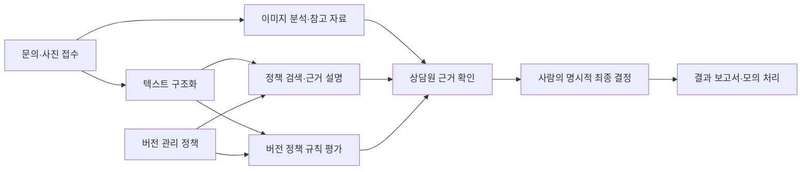

# CSight 2026 추계학술대회 2쪽 논문 작성 참고서

- 작성·자료 확인일: 2026-10-18 KST
- 대상: **한국디지털콘텐츠학회 2026 추계종합학술대회 및 대학생논문경진대회**. 사용자가 국내 추계대회임을 확인했다.
- 목적: 캡스톤의 문제 해결 과정, 시스템 설계·구현, 산업적 활용 가치를 중심으로 2쪽 논문을 작성하기 위한 내부 참고 문서.
- 권장 유형: **응용 시스템 설계·구현 논문**. 대학생 부문에 해당하면 캡스톤 작품을 포함하는 학생 전용 양식을 사용한다. 저자의 학적·제출 부문은 제출 전에 확정한다.
- 확인 범위: 저장소 설계·ADR·코드 및 기존 결과 파일 대조, 공식 제출 안내·HWP 본문 확인. 이번 작업에서 실험·모델 호출·서버 기동·사용자 평가를 새로 실행하지 않았다.
- 산출물 범위: 이 문서는 작성 참고서이며, 제출용 HWP나 최종 2쪽 조판본은 아니다.

> **핵심 서술:** CSight는 상품 불량 상담에서 문의·사진 확인, 정책 근거 조회, 담당자 판단, 결과 문서화를 연결한 의사결정 지원 시스템이다. 논문의 중심 기여는 업무 요구를 분석하고, AI 분석과 최종 결정의 책임을 분리하며, 근거를 추적할 수 있는 상담 흐름을 설계·구현한 데 둔다.

## 1. 먼저 결정할 논문의 중심

### 1.1 권장 제목

**상품 불량 상담 지원을 위한 이미지·텍스트 기반 CSight 플랫폼의 설계 및 구현**

대안:

1. 정책 근거와 담당자 검토를 연계한 상품 불량 CS 의사결정 지원 시스템
2. 상품 불량 상담의 업무 통합을 위한 CSight 캡스톤 디자인
3. 멀티모달 분석과 사람 검토를 활용한 상품 불량 상담 지원 플랫폼

첫 제목이 현재 근거에 가장 잘 맞는다. 이미지와 텍스트를 함께 활용하는 시스템이라는 점을 드러내면서, 새로운 멀티모달 융합 알고리즘을 제안했다는 오해를 피한다. 두 번째 제목에서 ‘캡스톤 디자인’은 실제 교과·팀 프로젝트 이력과 맞을 때 사용한다.

일반 부문에서 영문 제목이 필요하면 다음을 사용할 수 있다.

> Design and Implementation of CSight: An Image- and Text-Based Decision Support Platform for Product Defect Customer Service

### 1.2 한 문장으로 정의할 연구 질문

> 상품 불량 상담의 여러 근거와 처리 단계를 연결하면서, AI 분석의 불확실성을 담당자가 확인하고 최종 결정을 추적할 수 있는 업무 지원 시스템을 어떻게 설계할 것인가?

‘얼마나 높은 결함 정확도를 달성했는가’나 ‘몇 퍼센트의 인건비를 줄였는가’를 현재 논문의 연구 질문으로 삼지 않는다. 그 질문을 택하면 별도의 대표 데이터·비교 실험·사람 평가가 핵심 증거가 되어야 한다.

### 1.3 전면에 배치할 기여 세 가지

| 기여 | 논문에서 강조할 내용 | 현재 근거 |
|---|---|---|
| 업무 단계의 통합 | 문의·사진·관련 정책·검토·보고서를 하나의 사례 단위로 연결 | 실제 콘솔, 분석·검색·검토·보고서 구현 |
| 판단 책임의 분리 | AI는 분석과 설명을 제공하고, 정형 정책과 인증된 담당자 확인을 거쳐 결정 | 버전 정책 엔진, Human Review, 명시적 최종 확인 |
| 근거의 추적 가능성 | 당시 모델·프롬프트·정책·검색 근거와 사람 결정 기록을 연결 | Analysis Run, Citation Pack, Review Packet, 결정·보고서 이력 |

비동기 처리, 포트·어댑터, 독립 모델 서버는 이 기여를 가능하게 한 구현 방법으로 소개한다. 사용 기술 목록을 연구 기여 목록처럼 길게 나열하지 않는다.

## 2. 공식 제출 형식과 적용 방법

### 2.1 확인한 제출 요건

| 항목 | 2026-10-18 확인 내용 |
|---|---|
| 행사 | 2026-11-19~20, 수원컨벤션센터 |
| 논문 마감 | 2026-10-26 |
| 논문 길이 | 2단 편집, 1~2쪽 |
| 대학생 분야 | ICT 전 분야 및 캡스톤디자인 작품, 포스터 발표 |
| 일반 분야 | 생성형 AI·AI 에이전트, AI+X 등을 포함, 구두·포스터 발표 |
| 제출 파일 | **PDF가 아닌 한글 파일**. 일반·대학생 전용 양식이 다름 |
| 사전등록 | 2026-10-14~11-02, 현장등록 불가 안내 |

출처: [학회 행사·논문 제출 안내](https://dcs.or.kr/homepage/custom/submit), [2026 추계 논문 양식 공지](https://dcs.or.kr/board/forms/article/284050). 일정과 규정은 제출 당일 다시 확인한다.

공식 양식:

- [대학생 논문 HWP](https://dcs.or.kr/homepage/boardMedia/222832)
- [일반 논문 HWP](https://dcs.or.kr/homepage/boardMedia/222831)

### 2.2 학생 양식을 우선 활용하는 경우

학생 양식의 기본 구성은 다음과 같다.

1. 연구 배경
2. 연구 내용
3. 현실적 제한 조건에 대한 검토
4. 기대효과 및 활용
5. 결론

이후 번호 없는 감사의 글과 참고 문헌을 배치한다.

머리 부분에는 국문 제목, 저자·소속·이메일·지도교수가 있다. **학생 양식에는 별도의 초록이나 영문 제목 항목이 없다.** 일반 양식에는 국영문 제목·저자·소속, 교신저자와 요약이 있으므로 두 형식을 섞지 않는다.

학생 양식의 제한조건 장은 생략 가능하며 핵심 조건을 두 개 이내로 설명하는 구성이다. 이 논문에서는 ‘근거가 불완전한 입력’과 ‘실제 업무에 영향 없는 검증 환경’을 짧게 다루면 설계 선택의 이유가 드러난다. 별도 장을 생략하더라도 결과의 표본과 검증 범위는 결과 문장·표 주석에 남긴다.

표·그림은 글자처럼 취급하고 앞뒤 간격을 유지한다. 제목은 자동 캡션 대신 양식 방식으로 작성하며, 예시는 휴먼명조 9pt·가운데 정렬이다. 꼬리말 페이지 번호를 넣지 않는다. 전체 글꼴·여백·행간은 원본 HWP 스타일을 유지한다. 이번에는 HWP 본문 지침을 확인했으며 최종 렌더링은 확인하지 않았다. [학생 양식 원문](https://dcs.or.kr/homepage/boardMedia/222832)

### 2.3 제출 폼에서 주의할 실제 항목

- ‘초록파일’이라고 표시되어 있어도 **작성한 논문 파일**을 업로드한다.
- 파일명은 `투고자명 - 논문제목.hwp` 형식을 따른다.
- 파일 아래의 큰 ‘초록’ 입력칸에는 안내에 따라 **실제 현장 참가자의 이름과 연락처**를 입력한다.
- 제목·저자·소속은 파일과 폼에서 일치시킨다. 폼의 교신저자와 학생 양식의 지도교수는 각 역할에 맞게 기입한다.

출처: [공식 논문 제출 폼의 안내문](https://dcs.or.kr/conference/fall2026/submit). 이 작업에서는 제출이나 등록을 수행하지 않았다.

## 3. 강점을 살리는 서술 전략

### 3.1 약점의 비중은 연구 범위를 정확히 정해서 줄인다

2쪽의 핵심은 ‘모든 기능을 증명했다’는 인상을 만드는 것이 아니라, **해결한 공학적 문제를 명확히 보여주는 것**이다. 모델 선택 과정 전체, 서버 복구 이력, 미채택 실험, 모든 개발 테스트 수를 본문에 넣을 필요는 없다. 다만 해당 실험의 성공률이나 우월성을 주장한다면 실패와 분모를 함께 보고해야 한다.

권장 순서:

1. 상담원이 실제로 수행해야 하는 작업을 설명한다.
2. 그 작업을 연결하는 설계 요구를 세 가지로 좁힌다.
3. 설계 선택을 구조도와 구현 내용으로 보여준다.
4. 그 설계가 의도대로 동작한 범위를 작은 검증표로 제시한다.
5. 산업적 활용 가능성을 구체적 업무·측정지표와 연결한다.
6. 검증 범위와 다음 평가를 짧게 명시한다.

### 3.2 현재 주장할 수 있는 동사

| 상태 | 사용할 표현 | 추가 근거가 필요한 표현 |
|---|---|---|
| 구현·코드 확인 | 설계하였다, 구현하였다, 연결하였다, 기록하도록 구성하였다 | 상용화하였다, 기업에서 운영 중이다 |
| 제한된 동작 검증 | 지정된 합성 시험에서 일치하였다, 해당 경로의 완료를 확인하였다 | 모든 환경에서 안정적이다, 실고객 정확도를 입증하였다 |
| 산업 기대효과 | 부담 감소를 지원한다, 줄일 수 있도록 설계하였다, 활용 가능성이 있다 | 처리시간을 단축하였다, 운영비를 절감하였다 |
| 후속 측정 | 비교 평가할 예정이다, 별도 검증이 필요하다 | 검증되지 않은 목표치를 달성 수치처럼 제시 |

### 3.3 표현 교정 예시

| 피할 문장 | 권장 문장 |
|---|---|
| AI가 불량을 판정하고 환불을 자동 처리한다. | AI 분석과 정책 근거를 담당자에게 제공하고, 담당자가 최종 결정을 확정하도록 구성하였다. |
| 멀티모달 융합으로 정확도를 높였다. | 텍스트 분석과 이미지 분석의 결과를 사례 단위로 함께 확인하도록 구성하였다. |
| 상담 업무를 완전 자동화했다. | 상담 준비, 근거 확인, 결정 기록과 문서화를 연결하였다. |
| 실험 결과 정확도 100%를 달성했다. | 합성 정책 시험 40건에서 규칙 일치율 1.00을 기록하였다. |
| 10건 모두 성공해 상용성을 검증했다. | 합성 문의와 선별 이미지 10건의 별도 Text-v2 연계 경로에서 검토대기 생성을 확인하였다. |
| 산업적 비용 절감 효과를 입증했다. | 근거 탐색과 기록 작성 부담 감소를 목표로 설계했으며, 경제성은 후속 현장 평가로 확인한다. |
| AI 정확도 70% 이상이면 승인한다. | 화면의 준비도 기준은 검토 기능의 조건이며, 모델 정확도나 결함 확률을 뜻하지 않는다. |
| 처리 이력으로 AI가 자동 학습한다. | 추후 품질 분석에 활용할 수 있도록 비식별 결과와 버전 정보를 구조화한다. |

## 4. 캡스톤의 공학설계 기여를 만드는 근거

### 4.1 요구 → 선택 → 구현 → 검증으로 설명한다

| 요구·제약 | 설계 선택 | 구현 산출물 | 검증 또는 후속 확인 |
|---|---|---|---|
| 생성 오류가 금전적 결정으로 이어지지 않아야 함 | 분석·규칙·최종 결정의 책임 분리 | 정책 근거를 포함한 검토 패킷, 인증된 담당자 확정 | 정책 Test 40, 검토 상태·권한 Test 30 |
| 모델 지연·실패 중에도 작업 상태를 추적해야 함 | API와 작업 실행 분리, 중복 처리 제어 | 비동기 Run·Stage·Attempt, Outbox, 재시도·부분 성공 기록 | 기존 회귀·장애 시험 기록. 이번 문서 작성에서 재실행하지 않음 |
| 재분석 후에도 과거 판단 근거가 남아야 함 | 실행별 버전·출처를 고정하고 새 이력을 추가 | 분석 이력, 정책 조항·버전, 인용·검토 스냅숏 | 기존 무결성 시험과 9/10 검토·인용 묶음 해시 확인 |
| 상담 화면의 정보량을 줄여야 함 | 사진·요약·결정을 먼저 제시, 상세 근거는 펼침 | 문의 중심 목록, 검토 화면 직행, 명시적 재확인 | UI 기능·배치 시험 기록. 상담시간과 판단 품질 비교는 미실행 |
| 기업별 자료와 실험 자료를 구분해야 함 | 고객사 범위·권한, 데이터 출처 분리 | tenant 경계, 비식별 자산, 합성/실운영 집계 구분 | 권한·출처 계약 시험. 고객 환경 운영 검증은 별도 |

핵심 근거: [ADR-0003](../../CSight_project_docs/docs/adr/0003-policy-and-human-final-decision.md), [아키텍처](../../CSight_project_docs/docs/03_ARCHITECTURE.md), [ADR-0130](../../CSight_project_docs/docs/adr/0130-inquiry-first-focused-review.md), [상담원 UI와 효과 측정 계획](../product/CONSULTANT_FOCUSED_UI_2026-09-11.md).

### 4.2 실제 설계 반복을 서술하는 방법

저장소에는 기술 상태 중심 화면에서 문의·사진·검토 중심 화면으로 전환한 과정과 멘토링 후 수정 기록이 있다. 이를 다음처럼 쓴다.

> 초기 구현에서 분리되어 제시되던 분석·정책 정보를 상담 사례 중심으로 재구성하였다. 이후 멘토링과 화면 검토를 반영하여 사진·문의 요약·검토 행동을 우선 배치하고, 상세 정책과 기술 이력은 필요에 따라 확인하도록 개선하였다.

출처: [제품 방향 전환 기록](../product/PRODUCT_DIRECTION_EVOLUTION_2026-08-28.md), [상담원 중심 UI 개선](../product/CONSULTANT_FOCUSED_UI_2026-09-11.md). 이를 ‘현직 상담원 대상 사용성 실험으로 효과를 검증했다’고 바꾸지 않는다.

캡스톤 교육 활동의 사실관계는 팀이 별도로 채운다.

| 확인 항목 | 기입할 자료 |
|---|---|
| 교과·학과·팀명 | 실제 공식 명칭 |
| 참여자와 역할 | 요구분석, UI, 백엔드, 모델·데이터, 검증 등 실제 기여 |
| 지도·멘토링 | 실제 지도교수, 피드백 내용과 날짜 |
| 설계 대안 | 팀이 비교한 대안과 선택 이유 |
| 산학 연계 | 협력 기업·담당자·실제 제공 자료가 있을 때만 기재 |

기업 요구를 가정한 설계와 특정 기업과 공동 수행한 산학 과제는 구분한다. 논문 저자·소속·감사의 글은 실제 기여와 지원 사실로 확정한다.

## 5. 산업적 가치의 구체화

### 5.1 ‘누가, 어떤 작업에서, 무엇을 얻는가’를 쓴다

| 사용자 | 지원할 업무 | 구현된 연결 | 기대효과 | 후속 측정지표 |
|---|---|---|---|---|
| 상담원 | 사진·문의·정책 확인 | 사례별 화면과 근거 연결 | 자료 탐색·화면 이동 부담 감소 | 검토시간 중앙값/p90, 화면 이동·원문 재확인 횟수 |
| CS 관리자 | 검토와 결정 근거 확인 | 버전 정책, 담당자·결정 이력 | 처리 기준 점검과 재검토 지원 | 결정 오류율, 상담원 간 일치도, 재검토율 |
| 분쟁·감사 담당자 | 당시 판단 과정 확인 | 인용 묶음·검토 패킷·결과 보고서 | 근거 회수와 사후 설명 지원 | 근거 회수시간, 필수 근거 누락률 |
| 운영 담당자 | 확인서·안내문 준비 | 사람 결정 후 문서화 | 반복 작성 부담 감소 | 초안 검토·수정시간, 필수 항목 누락률 |
| 품질 담당자 | 반복 문의와 처리 결과 파악 | 비식별 사례·버전 자산 | 향후 상품·정책별 품질 분석 기반 | 출처·버전 완전성, 분류 가능한 사례 비율 |

이 표의 기대효과는 현장 실측 결과가 아니다. 현재 구현이 효과를 낼 수 있는 경로와 평가할 대상을 정리한 것이다. [제품 목표·고객 가설](../../CSight_project_docs/docs/01_PROJECT_CHARTER.md), [업무 효과 측정 계획](../product/CONSULTANT_FOCUSED_UI_2026-09-11.md)

### 5.2 비교는 업무 구조 수준에서 한다

아래는 프로젝트가 해결 대상으로 설정한 수작업 시나리오와 제안 구조의 비교이며, 특정 기업·경쟁 제품을 측정한 결과가 아니다.

| 작업 | 수작업을 가정한 기준 흐름 | CSight의 제안 흐름 |
|---|---|---|
| 정보 확인 | 문의·사진·정책을 각각 확인 | 사례 화면에서 연결된 자료 확인 |
| 정책 적용 | 문서를 찾아 적용 조건 확인 | 검색 조항과 버전 규칙 결과를 검토 |
| 최종 판단 | 담당자가 판단·기록 | 담당자가 근거를 확인하고 명시적으로 확정 |
| 문서화 | 판단 사유와 결과를 수기 정리 | 결정·근거를 연결한 보고서 확인 |
| 사후 점검 | 흩어진 기록을 다시 수집 | 당시 실행·정책·결정 이력 조회 |

‘기존 시스템에는 이러한 기능이 없다’거나 ‘최초의 통합 플랫폼’이라고 쓰지 않는다. 현재 논문의 차별성은 **이 프로젝트가 선택한 문제·요구·설계의 결합**으로 설명한다.

### 5.3 적용 대상과 도입 경로

초기 적용 후보는 사진이 첨부된 상품 불량 문의가 반복되고, 자사 정책을 관리하는 브랜드사의 CS 조직이다. 이는 프로젝트의 고객 가설이며 계약·수요조사 성과가 아니다.

도입 시나리오는 다음처럼 제시할 수 있다.

1. 한 상품군과 명확한 정책 범위에서 상담 근거 조회 도구로 사용한다.
2. 담당자 판단과 시스템 자료를 비교하면서 누락·오류 유형을 기록한다.
3. 시간·품질·운영비를 확인한 뒤 적용 상품군과 조직을 확대한다.

현재 결제·물류·CRM·메일 발송은 실연동 성과가 아니다. 논문에는 ‘기존 업무 시스템과의 후속 연계를 고려한 구조’ 정도로 설명한다. 모델·이미지의 상업 사용권과 고객 데이터 사용 조건도 도입 전에 확정할 항목이다.

### 5.4 경제성 평가식 — 참고서용, 현재 성과 아님

건당 담당자 작업시간을 `t`, 월간 대상 건수를 `N`, 분당 인건비 환산값을 `w`, 실제 재배치 가능한 시간의 비율을 `α`라고 하면 다음을 후속 평가에 사용할 수 있다.

```text
월간 확보 가능 업무시간 = N × (t_기존 − t_CSight) / 60
월간 인력 가치 환산액 = N × (t_기존 − t_CSight) × w × α
월간 순편익 추정 = 인력 가치 환산액 + 중복 계산하지 않은 재작업 비용 감소 − 월간 운영비
```

`t`의 단위는 분이다. 확보한 시간이 곧바로 현금 지출 감소를 뜻하지는 않는다. `α`는 임의로 1로 두지 않고 실제 재배치·추가 처리 가능성을 확인한다. 운영비에는 추론, 장비 감가, 전력, 저장·백업, 유지보수, 정책 검수와 사용자 교육을 포함한다. 보고서 작성시간이 `t`에 포함됐다면 별도 절감액으로 다시 더하지 않는다.

현재 값이 없으므로 원화 금액이나 ROI 비율을 계산하지 않는다. 2쪽 본문에는 식보다 ‘탐색·검토·기록 부담 감소와 그 측정 계획’이 더 효율적이다.

## 6. 논문에 사용할 수 있는 실제 검증 근거

### 6.1 권장 결과표: 설계한 규칙과 연결 경로의 검증

| 검증 대상 | 자료·분모 | 확인한 결과 | 논문에서 뜻하는 것 |
|---|---|---|---|
| 버전 정책 엔진 | 합성 Test 40건; 별도 Dev 80건 | 규칙 일치율 1.00, 출처 유효성 1.00, 재실행 일치율 1.00; 금지된 최종 결정 0 | 정의한 규칙 구현의 일치성 |
| 사람 검토 절차 | 합성 Test 30건; 별도 Dev 60건 | 상태 전환·권한·감사 완전성 각 1.00; 무권한·Worker·Policy 생성 최종 결정 각 0 | 상태·권한·기록 절차의 일치성 |
| 실모델 연결 | 2026-09-10, 합성 문의와 선별 이미지 10건 | Text-v2 기반 검색·근거 설명 생성 및 별도 정책 평가·검토대기 생성 10/10; 사람 결정·외부 동작 0 | 해당 내부 경로의 연결·완료 확인 |

세 행은 **서로 다른 평가**다. 합쳐서 ‘80건 통합 정확도 100%’로 쓰지 않는다. 사람 검토 30건은 상담원 30명이나 사용자 만족도 조사가 아니다. 정책·검토 시험은 합성 규칙·상태 전이의 구현 검증이며 독립 현장 전문가의 판단 정답을 검증한 것이 아니다.

### 6.2 원본 파일과 정확한 키

| ID | 원본 | 확인할 필드 |
|---|---|---|
| E01 | [정책 Test 지표](../../evaluation/policy_engine_v1/results/test_metrics.json) | `record_count=40`, `rule_match_exact_accuracy=1.0`, `source_clause_validity=1.0`, `forbidden_final_decision_count=0` |
| E02 | [사람 검토 Test 지표](../../evaluation/human_review_workflow_v1/results/test_metrics.json) | `record_count=30`, `state_transition_accuracy`, `authorization_accuracy`, `audit_completeness_rate`, 각 금지 결정 count |
| E03 | [9/10 통합 검증 요약](../progress/TEST_DATA_RESET_2026-09-10.json) | `reload.*`, `stages.human_ui_feedback`, `verification.*` |
| E04 | [10건별 실제 연결 기록](../../local-data/internal-feedback-reset-20260910/workflow_report.json) | `cases[*].text_v2/retrieval/grounding/policy`, 고유 Case 10개, `retrieval_hits=3` |
| E05 | [최종 DB 감사](../../local-data/internal-feedback-reset-20260910/final_db_audit.json) | `counts.*`, `run_statuses.*`, `review_packet_hashes_verified=10`, `citation_packs_verified=10` |
| E06 | [SHADOW 통합 범위](../progress/SHADOW_HUMAN_FEEDBACK_2026-09-10.json) | `status_scope`, `worker_probe`, `stages.live_authenticated_workflow`, `stages.human_usage_feedback` |

평가 설계 해석은 [정책 엔진 단계 기록](../progress/SPRINT_5A_POLICY_ENGINE_CORE.md), [사람 검토 단계 기록](../progress/SPRINT_5B_HUMAN_REVIEW_WORKFLOW.md)을 함께 읽는다. 이 단계 문서의 ‘미구현’ 항목은 당시 시점의 기록이다. 후속 Sprint에서 구현된 UI·보고서까지 현재 미구현으로 해석하지 않는다.

### 6.3 10건 통합 결과의 정확한 범위

- 사진은 전부 새로 생성한 합성 이미지가 아니다. **합성 문의와 선별 이미지**라고 표현한다.
- E3 이미지 검증 10건과 별도 Text-v2 경로 10건이 기록돼 있다. 이것이 공동 모델의 의미 정확도를 평가했다는 뜻은 아니다.
- 전체 Analysis Run은 22회이며 성공 18회·부분 성공 4회다. 구형 Text-v1의 2개 사례에서 재시도를 포함한 부분 실패 4회가 남아 있다.
- 따라서 ‘모든 파이프라인 100% 성공’ 대신 **‘별도 Text-v2 연계 10/10 완료’**로 특정한다.
- 검토대기 생성까지 확인했으며 해당 10건의 사람 결정과 외부 업무 실행은 0건이다. ‘사람이 10건을 처리 완료했다’고 쓰지 않는다.
- 같은 날 실제 사용자 인증 UI 전체 사용과 사용성 피드백은 `NOT_RUN`이다. 격리 DB의 사람 결정 시험과 실제 사용자 연구는 다르다.

이 내용은 E03~E06에 남아 있다. 본문에서는 표본·단계·내부 검증이라는 조건을 표와 한두 문장으로 붙이면 충분하다.

### 6.4 그림·문장에서 지켜야 할 모델 역할

1. E3는 이미지 전체의 결함 후보 점수를 제공한다. 결함 종류·위치·박스·마스크를 출력하는 모델이 아니다.
2. 낮은 점수는 정상 확정이 아니다. 사진만으로 기능 고장이나 책임 소재를 확인했다고 표현하지 않는다.
3. 현재 연결 기록의 기본 검색은 RAW/HYBRID/Top-3이며 LLM Query Builder와 reranker는 호출하지 않았다.
4. 정책 검색·생성 설명·정형 규칙 평가는 역할이 다르다. 검색 문장이 곧 실행 규칙이 되는 것처럼 설명하지 않는다.
5. 과거 현실형 데모의 E3 결과는 `NOT_LINKED_TO_POLICY_INPUT`으로 기록돼 있다. 모든 정책 판단이 Vision 점수를 결합했다고 주장하지 않는다.
6. 인용 ID 유효성 1.0은 허용된 인용 ID를 사용했다는 구조적 검증이다. 의미 정확도 100%나 환각 제거를 뜻하지 않는다.

근거: [ADR-0096](../../CSight_project_docs/docs/adr/0096-separate-image-level-any-defect-assessment.md), [ADR-0128](../../CSight_project_docs/docs/adr/0128-internal-shadow-human-feedback.md), [현재 상태·원장](../progress/CURRENT_STATUS.md), [근거 설명 검증 코드](../../app/platform/grounding.py).

### 6.5 본문에서 생략해도 되는 보조 기록과 조건

| 자료 | 다루는 방법 |
|---|---|
| 1,493개 오프라인 테스트 통과 이력 | 개발 회귀 근거로 보관. 모델 정확도나 실사용 1,493건으로 쓰지 않음 |
| HDP-100 시나리오 36건·완전성 검사 9/9 | 합성 시나리오 자료 구성 증거. 36건의 실제 Vision 성능평가로 쓰지 않음 |
| E3 Top-100 재실행 100/100 | 선별된 정답 양성 사례의 연결 재현. 대표 정확도 평가가 아니므로 본문 성능표에서 제외 권장 |
| 20건 시연 데이터와 네 상품군 | 화면에서 표현한 시나리오 범위. 상품군별 정확도나 시장 대표성으로 쓰지 않음 |
| Query Builder 개발 실패·개별 Q5 과제 결과 | 모델 비교를 논문의 주장으로 삼지 않는다면 상세 실험은 생략 가능. 채택·우월성을 주장하면 실패와 비교 조건도 필요 |
| 공개 영상·로그인 경로 | 시연 자산의 과거 구현 근거. 현재 가용성 또는 고객 운영 증거로 쓰지 않음 |

특히 E3 제공 보고서를 넣고 싶다면 [모델 명세](../../evaluation/scenario_poc_hard_plastic_v1/model_manifest.json)의 `SUPPLIED_OFFLINE_REPORT`, `report_metrics_reproduced_by_csight=false`, 제품별 `NOT_EVALUATED`를 확인한다. 제공 보고서의 held-out 10,067장, precision 0.954333, recall 0.508422, threshold 0.8984375는 같은 조건으로 함께 다뤄야 한다. 좋은 precision만 떼어 CSight 전체 정확도로 제시하지 않는다. 이번 2쪽 설계 논문에는 이 성능표를 넣지 않는 편이 초점에 맞다.

## 7. 2쪽 지면 배분

학생 양식을 기준으로 다음 배분에서 시작한다. 비율과 글자 수는 편집 목표이며 공식 제한이 아니다. 실제 2쪽 여부는 원본 HWP에서 조판한 뒤 확인한다.

| 영역 | 권장 비중 | 들어갈 내용 |
|---|---:|---|
| 제목·저자·소속 | 10% | 실제 참여자·지도교수 정보 |
| 1. 연구 배경 | 12% | 상담 문제, 선행연구 1~2문장, 목적 |
| 2. 연구 내용 | 43% | 요구·설계·구현, 그림 1개, 검증표 1개 |
| 3. 현실적 제한 조건 | 5% | 핵심 조건 1~2개와 설계 대응 |
| 4. 기대효과 및 활용 | 15% | 탐색·일관성·문서화·사후 분석의 가치 |
| 5. 결론 | 5% | 기여와 후속 사람 평가 |
| 참고문헌·감사의 글 | 10% | 관련 문헌 3편, 실제 지원 내역만 |

본문 초벌은 약 2,800~3,600자를 출발점으로 삼되 그림·표·제목 크기에 따라 조정한다. 본문을 줄일 때는 기술 스택 나열, 반복된 목적 설명, 모델 세부 버전 순으로 줄인다. 결과의 분모·합성 여부·사람 결정 경계는 유지한다.

페이지 배치 예:

- 1쪽: 제목 → 연구 배경 → 요구·구조 설계 → 구조도.
- 2쪽: 구현·검증표 → 제한조건 → 산업적 기대효과 → 결론·참고문헌.

## 8. 그림 1개와 표 1개를 만드는 방법

### 8.1 권장 구조도

아래 Mermaid는 그림 제작용 원본이다. 제출 파일에는 작은 크기에서도 읽을 수 있는 도형으로 옮긴다. 구성 관계를 나타내며, 10건 모두 사람이 결정까지 완료했다는 실행 기록은 아니다.



그림 제목 예: **그림 1. 근거 확인과 사람 결정을 중심으로 한 CSight의 구성**

그림에서는 ‘AI 자동 환불’, ‘완전 자동 승인’, E3의 ‘정상/불량 확정’, 구현되지 않은 문자·사진 의미 융합을 표시하지 않는다. 정책 검색과 규칙 평가는 별도 상자로 둔다. 내부 IP·장비 사용자명·클라우드 키·로그 ID는 넣지 않는다.

2단 폭에서 위 구조가 너무 복잡하면 ‘접수 → 분석·정책 근거 준비 → 상담원 확인 → 결정·보고서’의 네 묶음으로 줄이고, 두 번째 묶음 안에 텍스트·이미지·검색·규칙을 구분한다.

### 8.2 본문용 검증표

표 제목 예: **표 1. 구성요소별 합성 시험 및 내부 연결 검증 결과**

| 대상 | 범위 | 결과 |
|---|---|---|
| 정책 규칙 | 합성 Test 40건 | 규칙 일치율 1.00; 금지 결정 0 |
| 검토 절차 | 합성 Test 30건 | 상태·권한·감사 지표 각 1.00 |
| 실모델 연결 | 합성 문의·선별 이미지 10건 | 별도 Text-v2 연계 검토대기 10/10 |

표 바로 아래에 붙일 주석:

> 각 행은 독립된 구현·연결 검증이다. 실제 고객 판단 정확도나 사용성·경제성 평가 결과를 의미하지 않는다.

실제 UI 그림이 꼭 필요하면 구조도와 대체하거나 구조도 옆 작은 부분 그림으로 제한한다. 선택 화면은 ‘사진·요약·사람의 확인’이 보이는 검토 화면이 좋다. 현재 실행 화면과 과거 캡처·합성 fixture를 구분하고, 사진 공개 사용권을 확인한다. 권리가 확인되지 않은 선별 데이터셋 사진은 직접 그린 구조도나 사용권이 확인된 자가 촬영 사진으로 대체한다.

## 9. 학생 양식에 맞춘 본문 초안

아래는 문장 재료로 바로 사용할 수 있는 초안이다. 제목·저자·소속·지도교수·감사의 글은 실제 정보로 채우고, 그림과 표는 8절을 사용한다. 참고문헌 번호는 11절과 연결된다. 실제 HWP에서 두 쪽 조판 검증은 아직 하지 않았다.

---

### 상품 불량 상담 지원을 위한 이미지·텍스트 기반 CSight 플랫폼의 설계 및 구현

저자: [실제 저자명] / 소속: [소속] / 지도교수: [성명]

### 1. 연구 배경

상품 불량 상담은 고객 문의와 사진을 확인하고, 주문 및 정책 정보를 조회한 뒤 처리 사유를 기록하는 여러 작업으로 구성된다. 이러한 자료가 분산되면 상담원은 근거를 반복적으로 탐색해야 하며, 사후 검토를 위해 판단 과정을 다시 정리해야 한다. 고객지원 현장의 선행연구는 생성형 AI 보조가 업무 생산성에 기여할 가능성을 보고하였다[3]. 다만 상품 불량 상담에서는 사진에서 확인할 수 있는 정보와 고객의 주장, 기업 정책에 따른 처리 조건을 구분할 필요가 있다.

본 연구는 문의·사진 분석, 정책 근거 조회, 담당자 판단 및 결과 문서화를 사례 단위로 연결하는 CSight를 설계하고 구현한다. 설계 목표는 상담 자료의 통합, 분석과 최종 결정의 책임 분리, 판단 근거의 추적 가능성 확보이다.

### 2. 연구 내용

#### 2.1 시스템 설계

CSight는 상담원 웹 화면, 업무 처리 코어, 독립된 텍스트·이미지 분석 모듈로 구성된다. 텍스트 모듈은 문의의 요청과 결함 주장을 구조화하고, 이미지 모듈은 이미지 단위 결함 후보 정보를 제공한다. 정책 검색은 관련 조항을 찾아 근거 설명에 활용하며[1], 정형 정책 평가는 버전이 지정된 규칙으로 수행한다. 검색 결과와 생성 설명이 곧바로 최종 처리 결정이 되지 않도록 각 단계의 역할을 분리하였다.

상담원은 사진, 문의 요약과 정책 근거를 확인한 뒤 결정을 명시적으로 확정한다. 이 구조는 AI의 동작과 근거를 사용자가 확인하고 개입할 수 있도록 하는 사람–AI 상호작용 지침과 연결된다[2]. 분석을 다시 수행하면 새로운 실행 이력을 추가하고, 모델·프롬프트·정책 버전 및 근거 묶음을 연결하여 과거 판단의 검토를 지원한다.

#### 2.2 구현 및 업무 흐름

업무 코어는 모듈형 구조와 포트·어댑터 경계를 사용하여 모델 및 저장 기술을 분리하였다. 장시간 분석은 비동기 작업으로 실행하며, 작업 상태와 실패 이력을 보존한다. 상담 화면에서는 사진·저장된 요약·검토 행동을 우선 제시하고 상세 정책과 기술 이력은 펼쳐 확인하도록 구성하였다. 담당자의 최종 결정은 근거와 함께 기록하며, 이후 결과 보고서와 외부 처리 전 모의 검증으로 연결한다. 실제 환불·발송은 수행하지 않는다. 그림 1은 이러한 구성 관계를 나타낸다.

#### 2.3 동작 검증

정책 규칙과 사람 검토 절차는 각각 합성 시험 40건과 30건으로 확인하였다. 정책 규칙 일치율은 1.00이었으며, 검토 절차의 상태 전환·권한·감사 완전성 지표도 각각 1.00이었다. 별도의 내부 연결 시험에서는 합성 문의와 선별 이미지 10건을 사용하였다. Text-v2 분석을 바탕으로 검색·근거 설명을 생성하고, 별도 정책 평가와 검토대기 생성을 수행하는 경로가 10건 모두 완료되었다. 표 1의 결과는 각 구성요소의 구현과 해당 연결 경로에 한정된다. 구형 Text-v1의 재시도 포함 부분 실패 4회는 별도 이력으로 보존하였다.

### 3. 현실적 제한 조건에 대한 검토

이미지 분석 결과만으로 결함의 종류·위치나 처리 책임을 확정할 수 없으므로, 분석 결과는 담당자가 확인할 참고 자료로 제공한다. 또한 합성 문의와 구성된 정책을 이용한 내부 시험으로 범위를 제한하였다. 해당 실모델 연결 시험은 검토대기까지 확인했으며, 실제 상담원 평가와 기업 환경의 경제성은 별도 검증이 필요하다.

### 4. 기대효과 및 활용

CSight는 사진·문의·정책 자료를 연결하여 상담원의 근거 탐색을 지원하고, 결정과 보고서를 연결하여 반복적인 기록 작성 부담을 줄일 수 있도록 설계하였다. 정책 버전과 담당자 판단을 함께 보존하는 구조는 처리 기준 점검과 분쟁 시 근거 확인에 활용할 수 있다. 또한 비식별 처리 결과와 버전 정보를 축적함으로써 향후 반복 문의 및 상품별 품질 분석을 위한 자료 기반을 제공할 수 있다.

초기 적용 대상으로는 사진 기반 불량 문의가 반복되고 자사 정책을 관리하는 브랜드사의 CS 업무를 고려한다. 산업적 효과는 동일 사례를 이용한 기존 처리 방식과의 비교에서 검토시간, 판단 오류, 보고서 수정시간을 측정하여 평가할 계획이다. 시간 감소와 함께 판단 품질이 유지되는지를 확인함으로써 실제 도입 가치를 검토한다.

### 5. 결론

본 연구는 상품 불량 상담의 분석·정책·사람 검토·문서화를 연결한 CSight를 설계하고 구현하였다. 사례 중심 업무 통합, 판단 책임의 분리, 근거와 버전의 추적 구조를 제시하고 제한된 시험에서 구성요소 및 연결 동작을 확인하였다. 향후 실제 정책과 대표 사례, 상담원 평가를 통해 업무 품질과 산업적 효과를 검증할 예정이다.

---

초안에서 ‘검증할 예정이다’는 앞으로 수행할 계획을 뜻한다. 연구팀이 실제 후속 계획을 확정하지 않았다면 ‘검증이 필요하다’로 바꾼다. 참여 사실이 확인되면 2.1 앞에 ‘본 프로젝트는 [교과명]의 캡스톤 디자인으로 수행하였다’ 한 문장을 추가할 수 있다.

## 10. 일반 논문 양식을 사용하는 경우

일반 부문에 해당하면 공식 일반 HWP의 국영문 제목·저자·소속·교신저자·요약 영역을 따른다. 학생 양식의 지도교수 항목을 일반 양식에 임의로 옮기지 않는다.

본문은 ‘서론 → 시스템 설계 및 구현 → 검증 및 활용 → 결론’으로 합칠 수 있다. 요약 예시는 다음과 같다. 공식 원문에서 별도 요약 글자 수 제한을 확인하지 못했으므로 아래 길이는 편집용 제안이다.

> 본 논문은 상품 불량 상담의 문의·사진 확인, 정책 조회, 담당자 판단 및 결과 문서화를 연결하는 CSight를 제안한다. 텍스트·이미지 분석과 버전 정책을 분리하고, 상담원이 근거를 확인한 뒤 최종 결정을 확정하도록 구현하였다. 합성 정책 시험과 검토 절차 시험, 합성 문의·선별 이미지 기반 내부 연결 시험에서 구성요소와 검토대기 생성 경로의 동작을 확인하였다. 본 시스템은 상담 자료 탐색과 기록 작성, 판단 근거 추적을 지원하도록 설계되었으며, 실제 상담원 대상 품질·시간·경제성 평가는 후속 과제로 한다.

키워드 후보: 상품 불량 상담, 의사결정 지원, 이미지·텍스트 분석, 정책 검색, 사람 검토, 캡스톤 디자인. 최종 개수·표기 위치는 선택한 양식을 따른다.

## 11. 관련 문헌과 인용할 위치

아래 세 편은 각각 검색 기반 설명, 사람의 개입, 고객지원 산업의 필요성을 담당한다. 관련연구만 길게 쓰기보다 해당 설계·문제 설명 문장에 붙인다.

### [1] 검색 결과를 생성에 결합하는 기술 배경

P. Lewis et al., “Retrieval-Augmented Generation for Knowledge-Intensive NLP Tasks,” *Advances in Neural Information Processing Systems*, vol. 33, pp. 9459–9474, 2020.

- [NeurIPS 공식 논문 페이지](https://papers.nips.cc/paper/2020/hash/6b493230205f780e1bc26945df7481e5-Abstract.html)
- 사용 위치: 정책 검색 결과를 근거 설명에 활용하는 구조 설명.
- 연결할 주장: 외부 문서 검색을 생성과 결합하는 방법의 기술 배경.
- 이 논문을 인용하는 것만으로 CSight의 검색 정확도 향상이나 환각 제거가 입증되는 것은 아니다.

### [2] 사람이 AI 결과를 확인하고 개입하는 설계

S. Amershi et al., “Guidelines for Human-AI Interaction,” *Proceedings of the 2019 CHI Conference on Human Factors in Computing Systems*, pp. 1–13, 2019. DOI: 10.1145/3290605.3300233.

- [저자 소속기관 Microsoft Research의 논문 페이지](https://www.microsoft.com/en-us/research/publication/guidelines-for-human-ai-interaction/)
- 사용 위치: 근거 확인, 사용자 개입, 불확실한 분석의 취급.
- 연결할 주장: 시스템 설계의 해석·검토 근거. 실제 개발 시 참고했는지 확인되지 않았으면 ‘이 지침을 참고하여 개발했다’는 과거 사실을 만들지 않고 ‘지침과 연결된다’고 쓴다.
- CSight의 사용자 평가나 사용성 개선 효과를 대신하지 않는다.

### [3] 고객지원 분야에서 AI 보조의 산업적 맥락

E. Brynjolfsson, D. Li, and L. Raymond, “Generative AI at Work,” *The Quarterly Journal of Economics*, vol. 140, no. 2, pp. 889–942, May 2025. DOI: 10.1093/qje/qjae044.

- [정식 출판본](https://academic.oup.com/qje/article/140/2/889/7990658)
- 사용 위치: 연구 배경의 고객지원 업무와 AI 활용 필요성.
- 권장 문장: ‘고객지원 현장의 선행연구는 생성형 AI 보조가 업무 생산성에 기여할 가능성을 보고하였다.’
- 정식 출판본의 5,172명·평균 생산성 증가 15%는 해당 연구의 기업·측정 조건에서 나온 결과다. CSight에 대입하지 않는다. 본문에서는 숫자를 생략해도 충분하다.

프로젝트 내부 JSON·ADR은 이 참고서의 검증 근거다. 제출 논문의 관련연구 목록을 내부 파일 경로로 채우지 않는다. 공개 재현 자료가 필요하다면 개인정보·자료 사용권을 확인한 별도 묶음을 마련한다. 현재 비공개 저장소와 내부 이미지가 공개 부록으로 제공됐다고 쓰지 않는다.

## 12. 후속 실험을 한다면 우선할 것

논문을 강화할 다음 실험은 큰 모델을 추가하는 것보다, **기존 흐름 대비 검토 업무가 어떻게 달라지는지**를 확인하는 비교가 유용하다. 아래는 신규 실험 제안이며 완료 기록이 아니다.

1. 대상 상품군·정책·사례 범위를 먼저 고정한다. 명확한 문의와 추가 자료·예외가 필요한 문의를 구분한다.
2. 시스템 결과와 독립적으로 전문가 정답·정책 근거·추가 확인 필요 여부를 준비한다.
3. 같은 자료를 제공하는 기준 화면과 CSight를 비교한다. 참가자가 같은 사례를 두 번 풀며 답을 기억하는 효과를 피하도록 사례·순서를 교차 배정한다.
4. 참가자의 경력, 실제 상담원 여부, 과제 수, 제외·중단·실패 건수를 보고한다. 학생 대리 참가자는 실제 상담원으로 표현하지 않는다.
5. 시간은 분석 대기를 포함한 전체 시간과 담당자 능동 작업시간을 구분한다. 결정 후 보고서 검토까지 포함할지도 사전에 정한다.
6. 시간·화면 이동뿐 아니라 결정 오류, 추가 자료 누락, 근거 수정량을 함께 본다.
7. 모든 배정 사례를 분모에 남기고 실패·미완료를 별도 보고한다. 성공한 사례만 골라 시간 절감률을 만들지 않는다.
8. 품질이 유지되면서 시간이 줄었을 때만 효율 개선으로 해석한다. 필요한 표본 수는 변동성과 목표 효과를 바탕으로 정하며 임의의 소표본을 확증 실험으로 부르지 않는다.

현재는 이 실험을 수행하지 않았으므로 9절 초안의 산업효과를 ‘기대효과’로 유지한다.

## 13. 예상 질문에 대한 짧은 답변

| 질문 | 근거에 맞는 답변 방향 |
|---|---|
| 기존 모델과 도구를 연결한 것 이상의 기여가 있는가? | 상품 불량 상담의 요구를 분석·정책·사람 결정·보고서 책임으로 분리하고, 근거와 실행 버전을 추적하는 업무 흐름으로 구체화한 시스템 설계 기여다. 알고리즘 최초·우월성은 주장하지 않는다. |
| 멀티모달 모델을 새로 학습했는가? | 시스템에서 이미지와 텍스트 분석을 활용했다. 이 논문의 기여는 새 융합 모델의 학습이나 성능 향상이 아니다. |
| 10건이면 너무 작은 것 아닌가? | 10건은 해당 연결 경로의 기능 확인이다. 대표 고객 성능 추정은 별도 데이터·독립 정답·표본 설계가 필요하다. |
| 결과가 모두 1.00이면 평가가 너무 쉬운 것 아닌가? | 합성 규칙·상태·권한 계약의 구현 일치성 지표다. 모델 의미 품질이나 현장 효과의 대체 지표로 사용하지 않았다. |
| 산업적 이득을 실제로 측정했는가? | 현재는 탐색·검토·기록 지원 구조를 구현했다. 처리시간·품질·운영비 비교는 후속 평가 대상이다. |
| 사람이 결정하면 자동화 가치가 낮지 않은가? | 자료 정리·근거 검색·기록 작성의 지원도 검토할 가치가 있다. 실제 이득은 사람의 판단 품질을 유지하면서 측정해야 한다. |
| 낮은 이미지 점수는 정상이라는 뜻인가? | 아니다. 결함 후보 기준 미달이며 추가 근거나 사람 확인이 필요할 수 있다. |
| 실제 환불과 메일 발송까지 되는가? | 현재 결과는 모의 처리·문서화 범위다. 결제·물류·고객 연락의 실연동 성과를 주장하지 않는다. |
| 왜 지연시간이나 ROI 표가 없는가? | 본 논문의 평가 범위를 구현·연결 검증으로 한정했다. 단일 probe 지연이나 타 연구의 생산성 수치를 현장 성과로 대체하지 않았다. |

## 14. 제출 직전 체크리스트

### 내용·근거

- [ ] 제목·목적·결론이 모두 설계·구현 중심으로 일치한다.
- [ ] 실제 캡스톤 참여, 팀 기여, 지도교수·소속·지원 내역을 확인했다.
- [ ] 정책 40건·검토 30건·연결 10건의 서로 다른 분모를 구분했다.
- [ ] 합성 문의·선별 이미지·구성 정책임을 본문 또는 표 주석에 적었다.
- [ ] 검토대기 생성과 사람이 실제 결정을 완료한 것을 구분했다.
- [ ] E3의 결함 후보 점수를 정상 확정·유형·위치·환불 판단으로 확대하지 않았다.
- [ ] 전체 파이프라인 무실패나 모델·RAG 우월성을 주장하지 않았다.
- [ ] 산업적 기대효과를 실제 절감 성과와 구분했다.
- [ ] 사용한 그림·사진·로고의 공개 사용 조건을 확인했다.
- [ ] 원본 결과의 실패·버전·분모를 바꾸지 않았고 미채택 결과도 보존했다.

### 편집·제출

- [ ] 학적·발표 부문에 맞는 원본 HWP를 사용했다.
- [ ] 2단·최대 2쪽이며 그림·표·참고문헌까지 포함해 실제 페이지를 확인했다.
- [ ] 표·그림을 인쇄 크기로 읽을 수 있고 꼬리말 페이지 번호가 없다.
- [ ] 본문 인용 번호와 참고문헌이 일치한다.
- [ ] 제출 파일이 PDF가 아닌 한글 파일이다.
- [ ] 파일명, 실제 현장 참가자 입력, 저자 정보를 공식 폼과 대조했다.
- [ ] 10/26 제출 마감과 사전등록 기한을 최신 공지로 다시 확인했다.
- [ ] 접수 완료 화면·접수 식별자·제출 파일을 확인했다. 파일 작성과 접수 완료는 다르다.

## 15. 내부 근거를 읽을 순서와 현재 남은 일

### 15.1 우선 읽을 자료

1. [README](../../README.md): 프로젝트 정의와 구현 범위.
2. [현재 상태](../progress/CURRENT_STATUS.md): 최신 인계와 과거 관측 시각.
3. [제품 방향 전환](../product/PRODUCT_DIRECTION_EVOLUTION_2026-08-28.md): 기술 검증에서 상담 업무 중심 설계로 전환한 이유.
4. [상담원 UI 개선](../product/CONSULTANT_FOCUSED_UI_2026-09-11.md): 사용자 흐름과 후속 효과 측정.
5. [프로젝트 목표](../../CSight_project_docs/docs/01_PROJECT_CHARTER.md): 산업 문제와 고객 가설.
6. [ADR-0003](../../CSight_project_docs/docs/adr/0003-policy-and-human-final-decision.md), [ADR-0096](../../CSight_project_docs/docs/adr/0096-separate-image-level-any-defect-assessment.md), [ADR-0100](../../CSight_project_docs/docs/adr/0100-curated-closed-set-poc-admission.md), [ADR-0128](../../CSight_project_docs/docs/adr/0128-internal-shadow-human-feedback.md), [ADR-0130](../../CSight_project_docs/docs/adr/0130-inquiry-first-focused-review.md): 판단 권한·모델 역할·시연 자료·내부 피드백·UI 설계.
7. 6.2절의 E01~E06: 논문 수치의 직접 출처.
8. [Case Resolution 구조](../resolution/CASE_RESOLUTION_ARCHITECTURE.md), [Sprint 5C 기록](../progress/SPRINT_5C_CASE_RESOLUTION_CONSOLE.md): 사람 결정 이후 모의 처리와 보고서.

### 15.2 확인 시점과 남은 일

- 저장소의 마지막 운영 관측은 **2026-10-01 CSight 스택 종료**다. 이번 문서 작업에서 현재 가동 여부를 조회하거나 재기동하지 않았다. ‘현재 운영 중인 상용 서비스’라고 쓰지 않는다.
- 모델 후보의 출시 판정은 기존 `NO_WINNER`·`NO_RELEASE_ELIGIBLE` 상태를 유지한다. 이번 참고서는 모델 승격 판단을 변경하지 않는다.
- 남은 작성 작업: 제출 부문·저자 정보 확정 → 공식 HWP에 9절을 옮김 → 구조도와 검증표 배치 → 실제 2쪽 검수 → 공동저자 검토 → 제출·접수 확인.
- 남은 연구 작업: 대표 사례·실제 정책·독립 정답 확보, 상담원 시간·품질 비교, 사용권·고객 환경 운영 조건 확인.
- 이번 문서 검증: 근거 JSON 파싱, Gold의 Test 분모 40/30과 Manifest·지표 해시의 일치, 고유 Case 10개의 단계 상태, 전체 분석 22회의 성공/부분 성공 구분, 로컬 링크 33개의 대상 존재를 확인했다. 별도 검토자가 공식 양식·서지와 수치·역할 구분을 검토했고 표현을 보완했다. 새 모델 실험·서버 기능 시험·HWP 렌더링·학회 접수는 수행하지 않았다.
